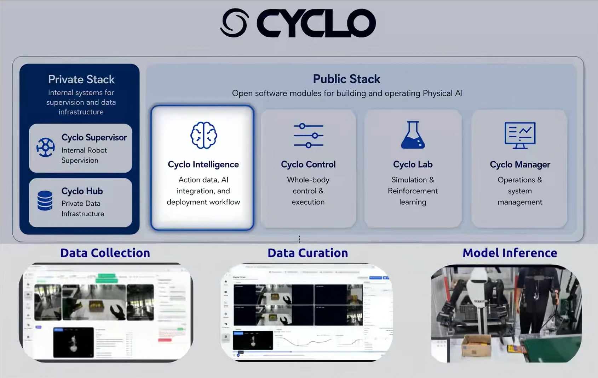
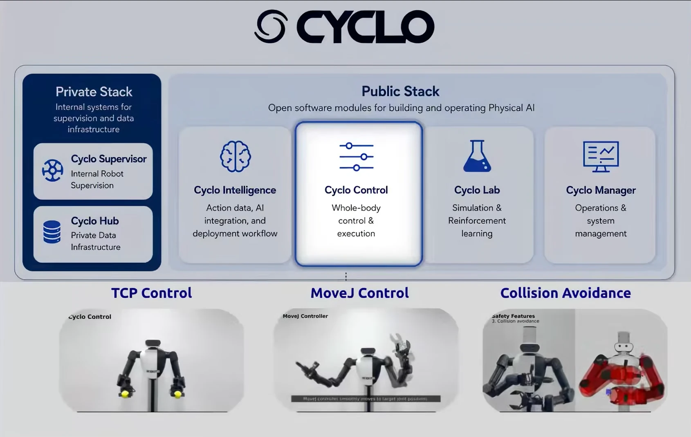
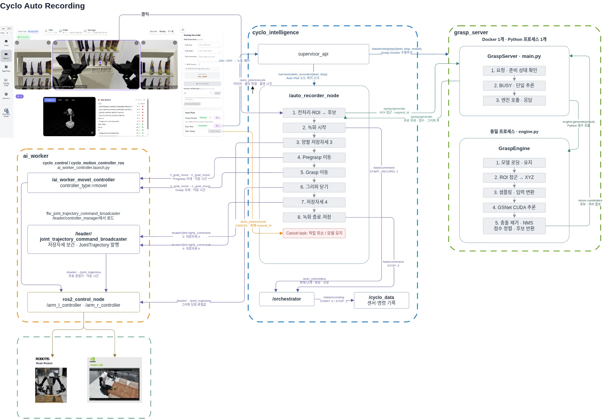

## System Setup

기존 ROBOTIS의 오픈소스 소프트웨어 위에 추가로 브라우저에서 화면 클릭시 데이터 자동수집하는 파이프라인 구축
했습니다.
**Cyclo Intelligence** : 데이터 수집·관리
**Cyclo Control**: 모션 플래닝·제어

<figure class="feature-media"></figure><figure class="feature-media"></figure>

#### 상세 시스템 흐름도 

## Data Collection
### Task: pick plastic bottle
<video controls autoplay muted loop playsinline preload="metadata" aria-label="8배속 연속 자동 수집. Isaac Lab 정면 시점에서 AI Worker가 테이블 위 여러 위치에 놓인 병을 차례로 집어 드는 시도를 반복한다"><source src="../assets/videos/ai-worker-auto-recorder-8x.mp4" type="video/mp4"></video>

### GraspNet과 CenterPose 

배치도

각 방법들 명시 하고 나눠서 
배치에서 성공률 을 배치마다 횟수 히스토그램으로 하자 
아래표도 위 에 중복되면 삭제하고 위로 재구성

| 수집                      | 시도  | 성공 시연       |
| ----------------------- | --- | ----------- |
| 1차 GraspNet (무작위 배치)    | 300 | 225 (75.0%) |
| 1차 CenterPose (무작위 배치)  | 300 | 248 (82.7%) |
| 2차 GraspNet (40위치 고정)   | 400 | 310 (77.5%) |
| 2차 CenterPose (40위치 고정) | 400 | 319 (79.8%) |

파지 후보 생성기로 GraspNet을 먼저 썼고, 결과가 고르지 않아 CenterPose(물체 자세 추정 모델)를 연결해 비교했습니다. CenterPose는 똑바로 선 병의 자세가 약 14~15° 기울어져 나오는 문제가 남아 있어, 병이 서 있다는 전제의 전용 파지 규칙을 함께 씁니다. 카메라 입력과 투영은 표식 9개를 6개 프레임에서 비교해 평균 0.66px 이내로 일치했으므로 원인이 아닙니다.

처음에는 무작위 배치로 비교해 결과 해석이 갈렸습니다. 그래서 병 위치를 5줄 × 8열 격자 40곳으로 고정하고, 위치마다 방식별 10회씩 반복했습니다.

그리고 해당 데이터셋 궤적 시각화 둘다 

두 방식의 차이는 1차 7.7%p에서 2차 2.3%p로 줄었습니다. 장면 구성도 달라서 위치 고정의 효과인지는 확정하지 못했습니다.

2차 실패 171건 중 169건은 역기구학(IK, 목표 자세에 맞는 팔 관절 각도 계산)에서 후보가 모두 탈락한 경우였습니다. 가장 먼 줄(X=0.295m)은 160시도 중 27회만 성공했고, X=0.430m와 0.475m 줄은 모두 성공했습니다. 40개 위치를 IK로 미리 검증하지 않아 관절 한계와 충돌 중 무엇이 원인인지는 분리하지 못했습니다.
위에는 먼가 말이 많ㄴ네 
## Policy & Training
트레이닝 model : NVIDIA GR00T N1.7
학습 GPU : RTX 5090(32GB) 
문제 :
고정한 언어·영상 부분(백본)을 FP32로 두면 fused AdamW를 써도 부족했고, 백본을 BF16(16비트 부동소수점)으로 불러오고 fused AdamW를 함께 쓰자 학습이 진행
언어 모델과 영상 인코더는 고정하고, 약 31.4억 개 파라미터 중 약 16.2억 개(연결부와 동작 생성부)만 학습
배치 크기 8,
학습률 0.0001
150,000스텝 
위에도 위 느낌처럼 교정

### 시뮬레이션 평가
평가는 수집과 같은 40개 위치 × 3회 × 2모델, 총 240회입니다. 시도당 30초이고 성공 기준은 수집과 같습니다. 학습에 쓴 위치를 다시 썼으므로 새 위치에 대한 일반화 성능은 아닙니다.

| 정책 학습 데이터 | 전체 | X=0.295 | X=0.340 | X=0.385 | X=0.430 | X=0.475 |
| --- | --- | --- | --- | --- | --- | --- |
| GraspNet 시연 310개 | 75/120 | 5/24 | 11/24 | 19/24 | 22/24 | 18/24 |
| CenterPose 시연 319개 | 75/120 | 1/24 | 14/24 | 20/24 | 22/24 | 18/24 |

전체 성공 횟수는 같았지만 줄별로는 달랐습니다. 정책 성공이 가장 낮은 줄은 수집 단계에서도 성공 시연이 가장 적었던 가장 먼 줄이었습니다. 위치당 3회로 표본이 작아 줄 단위 차이는 일반화하지 않습니다.

첫 평가에서는 두 정책 모두 거의 성공하지 못했습니다. 확인해 보니 저장 자세를 유지하는 컨트롤러가 일시정지 중에도 팔 명령을 내고 있었습니다. 이 컨트롤러를 끄고 매 시도 전에 외부 팔 명령이 없음을 확인한 뒤 다시 평가한 결과가 위 표입니다.

### 한계점
떨림발생 으로 인한 테스트 부정확 성 이 보임
