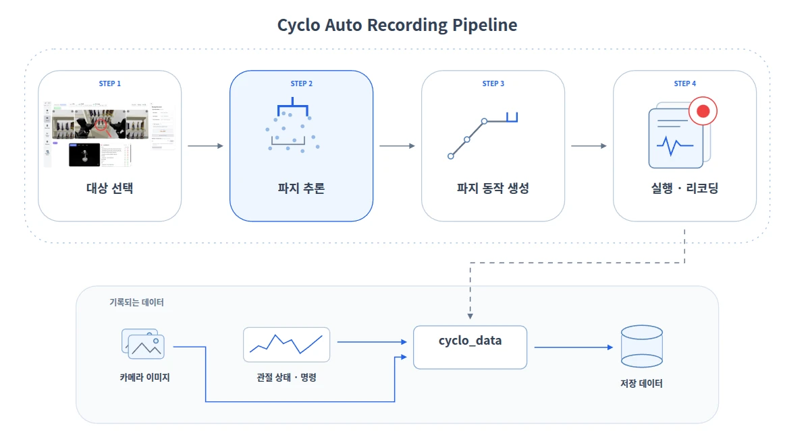

<!-- TODO 히어로 영상(촬영 예정), 사분할 화면: ① 브라우저에서 대상 병 클릭 ② Isaac Sim ③ RViz 점군 + 파지 후보 ④ RViz 로봇 모델 + 점군 + 최종 파지 + 궤적 -->

## System Setup

ROBOTIS의 로봇 소프트웨어 Cyclo 중 데이터 수집·관리를 맡는 Cyclo Intelligence와 모션 플래닝·제어를 맡는 Cyclo Control을 기반으로 삼았습니다. 그 위에 파지 추론부터 동작 계획, 녹화 종료까지 클릭 한 번으로 진행하는 파이프라인을 추가로 구축했습니다.

<figure class="feature-media"></figure><figure class="feature-media"></figure>

웹 화면에서 대상 병을 한 번 클릭하면 파지 추론, 파지 동작 생성, 실행과 녹화 저장이 사람 개입 없이 이어집니다.

파지 추론은 graspnet모델을 사용합니다. 별도 Docker 컨테이너로 띄워 cyclo의 supervisior_api로 실행, 종료를 감독합니다. 
#### 상세 시스템 다이어그램 

## Data Collection

실제 IKEA 가구가 배치된 탕비실을 시뮬레이션 에셋으로 불러오고 병을 추가로 렌더링해, 자동 수집 파이프라인을 시뮬레이션과 연동했습니다. 현재 대상은 녹차병 1종입니다.

### GraspNet과 CenterPose 비교

파지 후보 생성기로 GraspNet을 먼저 썼고, 결과가 고르지 않아 CenterPose(물체 자세 추정 모델)를 연결해 비교했습니다. CenterPose는 똑바로 선 병의 자세가 약 14~15° 기울어져 나오는 문제가 남아 있어, 병이 서 있다는 전제의 전용 파지 규칙을 함께 씁니다. 카메라 입력과 투영은 표식 9개를 6개 프레임에서 비교해 평균 0.66px 이내로 일치했으므로 원인이 아닙니다.

처음에는 무작위 배치로 비교해 결과 해석이 갈렸습니다. 그래서 병 위치를 5줄 × 8열 격자 40곳으로 고정하고, 위치마다 방식별 10회씩 반복했습니다.

| 수집 | 시도 | 성공 시연 |
| --- | --- | --- |
| 1차 GraspNet (무작위 배치) | 300 | 225 (75.0%) |
| 1차 CenterPose (무작위 배치) | 300 | 248 (82.7%) |
| 2차 GraspNet (40위치 고정) | 400 | 310 (77.5%) |
| 2차 CenterPose (40위치 고정) | 400 | 319 (79.8%) |

두 방식의 차이는 1차 7.7%p에서 2차 2.3%p로 줄었습니다. 장면 구성도 달라서 위치 고정의 효과인지는 확정하지 못했습니다.

2차 실패 171건 중 169건은 역기구학(IK, 목표 자세에 맞는 팔 관절 각도 계산)에서 후보가 모두 탈락한 경우였습니다. 가장 먼 줄(X=0.295m)은 160시도 중 27회만 성공했고, X=0.430m와 0.475m 줄은 모두 성공했습니다. 40개 위치를 IK로 미리 검증하지 않아 관절 한계와 충돌 중 무엇이 원인인지는 분리하지 못했습니다.

## Policy & Training

2차 수집의 두 데이터셋으로 NVIDIA GR00T N1.7(영상·언어·로봇 상태를 보고 동작을 출력하는 VLA 모델, Vision-Language-Action)을 각각 학습했습니다. 입력은 머리 카메라 1개와 손목 카메라 2개입니다.

RTX 5090(32GB) 한 장에서는 기본 설정이 첫 최적화 단계에서 메모리가 부족해 한 번도 갱신하지 못했습니다. 고정한 언어·영상 부분(백본)을 FP32로 두면 fused AdamW를 써도 부족했고, 백본을 BF16(16비트 부동소수점)으로 불러오고 fused AdamW를 함께 쓰자 학습이 진행됐습니다.

언어 모델과 영상 인코더는 고정하고, 약 31.4억 개 파라미터 중 약 16.2억 개(연결부와 동작 생성부)만 학습했습니다. 배치 크기 8, 학습률 0.0001로 150,000스텝 학습했습니다.

### 시뮬레이션 평가

평가는 수집과 같은 40개 위치 × 3회 × 2모델, 총 240회입니다. 시도당 30초이고 성공 기준은 수집과 같습니다. 학습에 쓴 위치를 다시 썼으므로 새 위치에 대한 일반화 성능은 아닙니다.

| 정책 학습 데이터 | 전체 | X=0.295 | X=0.340 | X=0.385 | X=0.430 | X=0.475 |
| --- | --- | --- | --- | --- | --- | --- |
| GraspNet 시연 310개 | 75/120 | 5/24 | 11/24 | 19/24 | 22/24 | 18/24 |
| CenterPose 시연 319개 | 75/120 | 1/24 | 14/24 | 20/24 | 22/24 | 18/24 |

전체 성공 횟수는 같았지만 줄별로는 달랐습니다. 정책 성공이 가장 낮은 줄은 수집 단계에서도 성공 시연이 가장 적었던 가장 먼 줄이었습니다. 위치당 3회로 표본이 작아 줄 단위 차이는 일반화하지 않습니다.

첫 평가에서는 두 정책 모두 거의 성공하지 못했습니다. 확인해 보니 저장 자세를 유지하는 컨트롤러가 일시정지 중에도 팔 명령을 내고 있었습니다. 이 컨트롤러를 끄고 매 시도 전에 외부 팔 명령이 없음을 확인한 뒤 다시 평가한 결과가 위 표입니다.

### 한계점

떨림발생 으로 인한 테스트 부정확 성 이 보임

| 한계 | 다음 검증 |
| --- | --- |
| 모든 결과가 시뮬레이션이다 | 실물 센서·좌표계·그리퍼 조건에서 별도 평가 |
| 학습 위치에서만 평가했고, 데이터셋마다 정책을 한 번만 학습했다 | 학습에 쓰지 않은 위치에서 평가 |
| 가장 먼 줄의 부진 원인을 분리하지 못했다 | 40개 위치 IK 사전 검증, 위치별 수집 수를 맞춘 재학습 |
| 텔레오퍼레이션 데이터와 품질을 비교하지 않았다 | 같은 양의 텔레오퍼레이션 데이터로 학습한 정책과 비교 |
| 성공 기준이 0.5초 유지까지이고, 대상이 녹차병 1종이다 | 운반 완료 기준 추가, 물체 종류 확대 |
