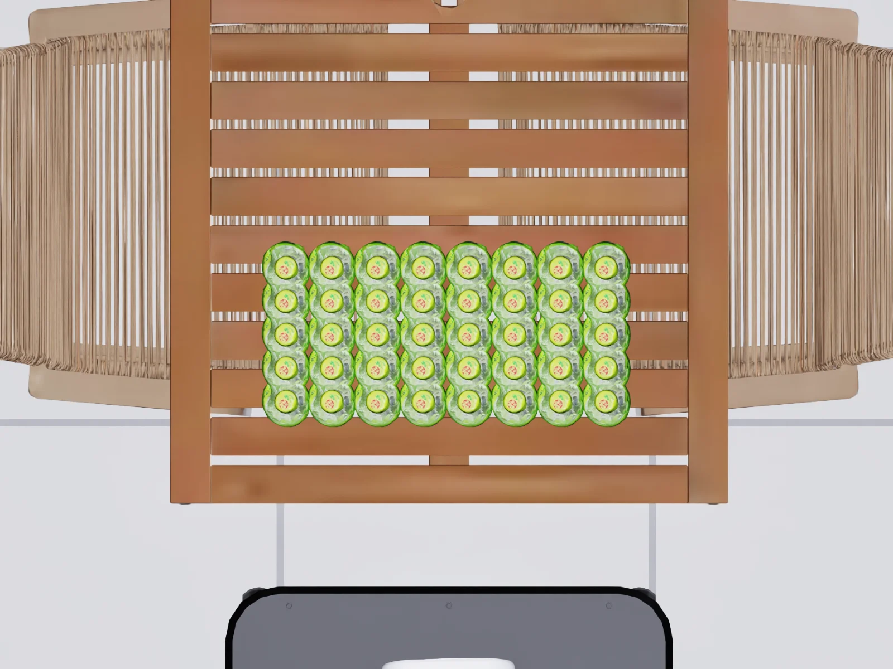
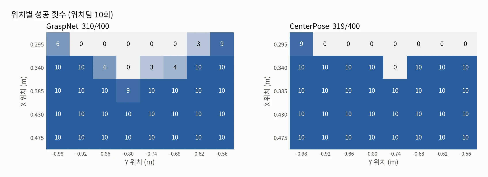
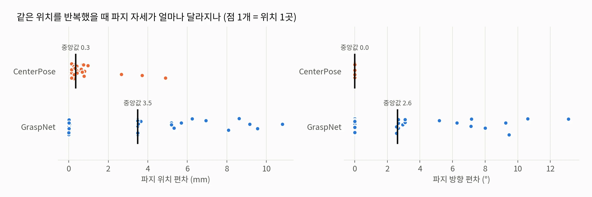
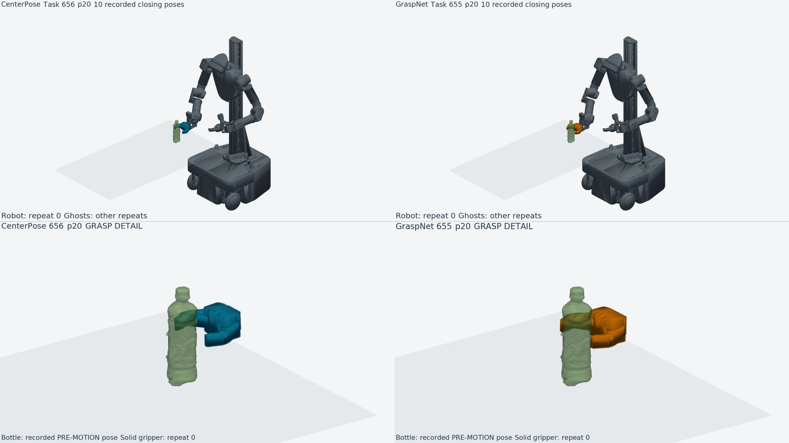
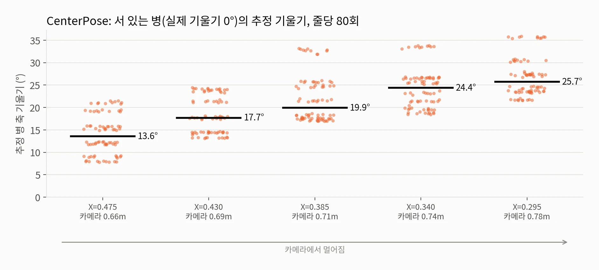
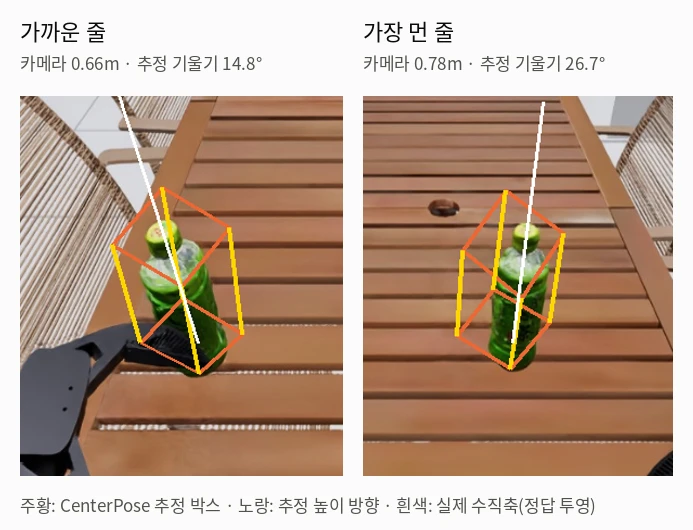
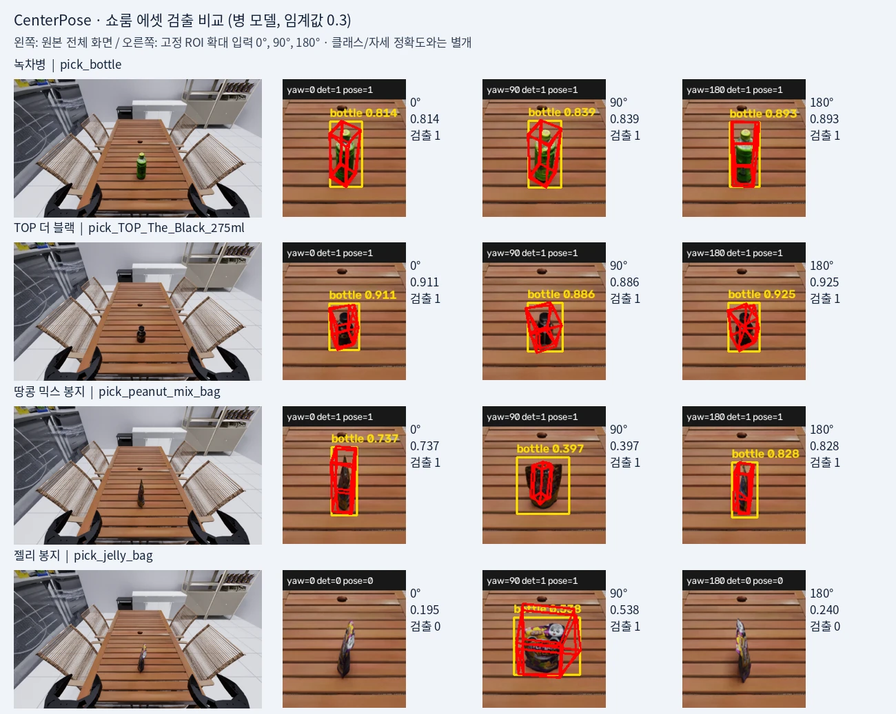
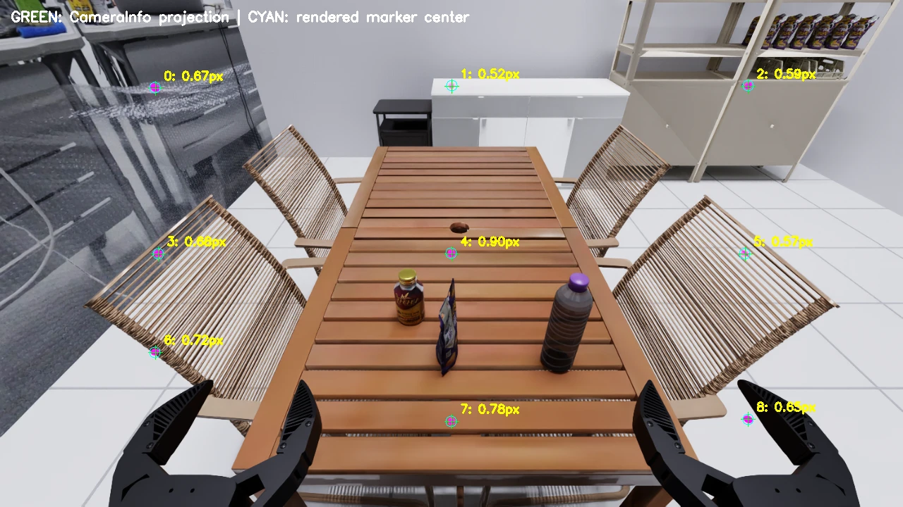

## System Setup

기존 ROBOTIS의 오픈소스 소프트웨어 위에 추가로 브라우저에서 화면 클릭시 데이터 자동수집하는 파이프라인 구축
했습니다.
**Cyclo Intelligence** : 데이터 수집·관리
**Cyclo Control**: 모션 플래닝·제어

<figure class="feature-media"></figure><figure class="feature-media"></figure>

#### 상세 시스템 흐름도 

### 데이터 수집
#### Task: pick plastic bottle
<video controls autoplay muted loop playsinline preload="metadata" aria-label="8배속 연속 자동 수집. Isaac Lab 정면 시점에서 AI Worker가 테이블 위 여러 위치에 놓인 병을 차례로 집어 드는 시도를 반복한다"><source src="../assets/videos/ai-worker-auto-recorder-8x.mp4" type="video/mp4"></video>

병 위치를 5줄 × 8열 격자로 고정하고, 위치마다 10회씩 총 400회를 시도해 성공 시연 319개(79.8%)를 모았습니다. 성공 기준은 3.5cm 이상 들어 0.5초 유지하고 녹화가 저장된 경우입니다. 

### 모델 학습
트레이닝 model : NVIDIA GR00T N1.7
학습 GPU : RTX 5090(32GB) 
언어 모델과 영상 인코더는 고정하고, 약 31.4억 개 파라미터 중 약 16.2억 개(연결부와 동작 생성부)만 학습
배치 크기 8,
학습률 0.0001
150,000스텝 

## 평가
#### 시뮬레이션
수집한 시연 319개로 학습한 정책을 수집과 같은 40개 위치에서 위치당 3회씩 평가했습니다. 시도당 30초이고 성공 기준은 수집과 같습니다. 학습에 쓴 위치를 다시 썼으므로 새 위치에 대한 일반화 성능은 아닙니다.

|  | 전체 | X=0.295 | X=0.340 | X=0.385 | X=0.430 | X=0.475 |
| --- | --- | --- | --- | --- | --- | --- |
| 정책 성공 | **75/120 (62.5%)** | 1/24 | 14/24 | 20/24 | 22/24 | 18/24 |
| 수집 성공 (참고) | 319/400 | 9/80 | 70/80 | 80/80 | 80/80 | 80/80 |

가장 먼 줄(X=0.295m)은 수집 시연이 9개뿐이었고 정책 성공도 1/24에 그쳤습니다. 이 줄의 원인인 팔 도달 범위(IK)는 남은 문제에 정리했습니다. 위치당 3회로 표본이 작아 줄 단위 차이는 일반화하지 않습니다.

## Challenge 1: 파지 후보 생성기 선택 (GraspNet vs CenterPose)

#### 문제
GraspNet으로 모은 수집 결과가 고르지 않다는 피드백을 받았습니다. 클릭한 병을 어떤 자세로 잡을지 후보를 만드는 단계에 CenterPose 방식을 붙여 같은 조건에서 비교했습니다.
**질문: 후보 생성기를 바꾸면 수집 결과와 학습된 정책이 달라지는가?**
범위: Isaac Lab 시뮬레이션, 서 있는 녹차병 1종. 실물 로봇과 다른 물체는 남은 문제에 두었습니다.

|       | GraspNet (GSNet)    | CenterPose + 고정 파지 규칙 |
| ----- | ------------------- | --------------------- |
| 입력    | 클릭 주변 점군            | RGB 이미지 + depth       |
| 출력    | 6자유도 파지 후보 여러 개와 점수 | 병 3D 박스 → 중심 위치       |
| 파지 방향 | 모델이 후보마다 추정         | 고정 규칙 (추정 자세는 쓰지 않음)  |
| 물체 가정 | 없음                  | 서 있는 병                |
| 충돌 검사 | 점군 기준 필터            | 없음 (IK 검증만)           |
| 연산    | GPU (CUDA)          | CPU (ONNX Runtime)    |

#### 확인 1: 40위치 고정 × 위치당 10회 수집 비교
위치 영향과 생성기 영향을 나눠 보려고 병 위치를 고정하고, 위치마다 방식별로 10회씩 시도했습니다.

|  | GraspNet | CenterPose |
| --- | --- | --- |
| 성공 | 310/400 (77.5%) | 319/400 (79.8%) |
| X=0.295m (가장 먼 줄) | **18/80** | 9/80 |
| X=0.340m | 53/80 | **70/80** |
| X=0.385·0.430·0.475m | 239/240 | 240/240 |
| 같은 위치 반복 시 파지 위치 편차 (중앙값 / 상위 10%) | 3.5mm / 8.5mm | **0.3mm / 0.9mm** |
| 같은 위치 반복 시 파지 방향 편차 (중앙값 / 상위 10%) | 2.6° / 8.9° | **0.0° / 0.0°** |
| 최대 들기 높이 중앙값 | 5.3cm | 5.4cm |
| 시도당 소요 시간 중앙값 | 28.6초 | 27.6초 |

편차는 성공한 시도의 Grasp 목표 자세를 위치별로 모아, 위치 표준편차와 평균 방향으로부터의 각도 차이로 계산했습니다(2회 이상 성공한 위치만: GraspNet 34곳, CenterPose 32곳).

실패 171건 중 169건은 IK 탈락이었고, 가장 먼 줄(X=0.295m)에 몰렸습니다(성공 27/160). X=0.430·0.475m 줄은 모두 성공했습니다. 관절 한계 때문인지 충돌 때문인지는 분리하지 못했습니다.

#### 확인 2: CenterPose의 한계
**1. 자세가 기울어 나오고, 멀수록 더 기울어짐.** 위 실험 400회에서 서 있는 병의 추정 높이축이 수직에서 벗어난 각도를 줄별로 계산했습니다.

| 줄 | 카메라까지 거리 | 내려다보는 각도 | 기울기 중앙값 (상위 10%) | 수평 중심 오차 중앙값 | 수집 성공 |
| --- | --- | --- | --- | --- | --- |
| X=0.295m | 0.78m | 44° | 25.7° (35.4°) | 17mm | 9/80 |
| X=0.340m | 0.74m | 46° | 24.4° (33.3°) | 19mm | 70/80 |
| X=0.385m | 0.71m | 48° | 19.9° (31.9°) | 11mm | 80/80 |
| X=0.430m | 0.69m | 51° | 17.7° (24.0°) | 10mm | 80/80 |
| X=0.475m | 0.66m | 54° | 13.6° (20.9°) | 10mm | 80/80 |

카메라에서 멀수록 기울기와 중심 오차가 커졌습니다. 다만 멀수록 카메라가 덜 내려다보게 되므로, 거리 때문인지 보는 각도 때문인지는 나누지 못했습니다. 카메라 자체는 원인이 아닙니다. 알려진 표식 9개를 6프레임에서 투영해 평균 0.66px로 일치했습니다. 그래서 추정 방향은 버리고 중심 위치만 쓰며, 방향은 서 있는 병 전용 규칙으로 정했습니다. 이 비교는 **범용 파지 모델과 병 전용 규칙의 비교**입니다.

**2. 물체 종류마다 모델이 따로 필요하고, 점수로 종류를 가리지 못함.** CenterPose는 병·시리얼 상자처럼 범주별로 모델이 나뉩니다. 쇼룸 에셋 11종 × 회전 3개로 시험했을 때(추가 학습 없음, 임계값 0.3) 병 모델은 플라스틱 병뿐 아니라 커피캔 5종(15/15장)과 과자 봉지(땅콩 3/3, 군밤 2/3)에도 병으로 반응했습니다.

**3. 화면에서 작게 보이면 검출하지 못함.** 같은 시험에서 카메라 전체 화면(672×376)을 넣으면 병 9장 중 0장, 병 주변을 잘라 넣으면 9장 모두 검출했습니다. 수집 실험은 1280×720에서 병이 약 160~180px 높이로 보여 검출됐습니다.

> 그림 예정: 누운 병에서 CenterPose·GraspNet 후보 비교 캡처 (미촬영)

#### 결정
|  | GraspNet | CenterPose + 규칙 |
| --- | --- | --- |
| 장점 | 가장 먼 줄에서 2배 성공 (18 vs 9/80) | 같은 위치면 거의 같은 파지 (편차 0.3mm·0°) |
|  |  | X=0.340m 줄에서 더 많이 성공 (70 vs 53/80) |
| 단점 | 파지 자세가 시도마다 다름 (편차 3.5mm·2.6°, 상위 10% 8.5mm·8.9°) | 추정 자세가 14~26° 기울어 방향을 쓸 수 없음 (멀수록 악화) |
|  | X=0.340m 줄 53/80 | 가장 먼 줄 9/80 |
|  |  | 병 모델이 캔·봉지에도 반응, 작게 보이면 미검출 |
| 전체 수집 성공 | 310/400 | 319/400 (차이 9회, 뚜렷한 우열로 보기 어려움) |
| 학습된 정책 | 75/120 | 75/120 |

학습된 정책을 줄별로 보면 다음과 같습니다(위치당 3회).

| 정책 학습 데이터 | 전체 | X=0.295 | X=0.340 | X=0.385 | X=0.430 | X=0.475 |
| --- | --- | --- | --- | --- | --- | --- |
| GraspNet 시연 310개 | 75/120 | 5/24 | 11/24 | 19/24 | 22/24 | 18/24 |
| CenterPose 시연 319개 | 75/120 | 1/24 | 14/24 | 20/24 | 22/24 | 18/24 |

- **정책 성능은 같았습니다.** 수집 단계의 차이가 학습 결과까지 이어지지는 않았습니다.
- **"결과가 고르지 않다"는 피드백은 측정으로 확인됐습니다.** GraspNet은 같은 위치에서도 파지 자세가 달랐습니다.
- **가장 큰 병목은 생성기가 아니라 팔이 닿는 범위(IK)였습니다.** 실패 171건 중 169건.
- **테스트하지 않은 것:** 누운 병, 다른 형상에서 GraspNet의 파지 성공, 실물 로봇. 수집은 녹차병 1종 시뮬레이션 결과입니다.

서 있는 병 한 종류를 모으는 이번 수집에는 CenterPose 방식이 맞습니다. GraspNet의 범용성은 다른 형상 태스크에서 검증할 다음 단계입니다.

## Challenge 2: 학습 메모리 부족

#### 문제
RTX 5090(32GB)에서 GR00T N1.7 학습이 메모리 부족으로 진행되지 않았습니다.

#### 확인
고정한 언어·영상 부분(백본)을 FP32로 두면 fused AdamW를 써도 부족했습니다.

#### 해결
백본을 BF16(16비트 부동소수점)으로 불러오고 fused AdamW를 함께 썼습니다.

#### 결과
학습이 진행되어 150,000스텝까지 학습했습니다.

<!-- 메모: 위에도 위 느낌처럼 교정 -->

## 남은 문제

- **떨림:** 떨림 발생으로 테스트가 부정확해 보임
- **팔이 닿는 범위(IK):** 두 방식 800회의 수집 실패 171건 중 169건이 IK 탈락이고, 가장 먼 줄에 몰림. 관절 한계와 충돌 중 어느 쪽인지 분리하지 못함
- **검증하지 않은 조건:** 누운 병, 다른 형상, 실물 로봇
