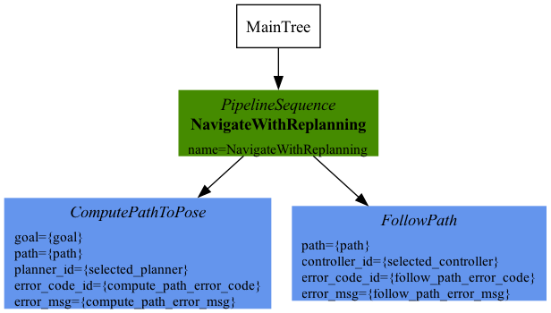

## 기존 방식

기존 시스템은 로봇 소프트웨어 프레임워크인 ROS(Robot Operating System) 1 Noetic과 자율주행 패키지 move_base를 사용했습니다. 로봇의 동작은 상태 머신(State Machine)으로 관리했습니다.

ROS 1의 유지보수 지원이 종료됐습니다. move_base에서 선택할 수 있는 주행 알고리즘과 기존 시스템 구조에도 서비스 확장의 제약이 있었습니다.

## 개선 방식

3차원 레이저 센서인 3D LiDAR(Light Detection and Ranging)로 지도를 만들며 동시에 위치를 추정하는 알고리즘(SLAM, Simultaneous Localization and Mapping)과 사전 지도에서 현재 위치를 찾는 기능을 선별해 ROS 2 Humble로 옮겼습니다.

경로 계획과 주행 제어는 Nav2(Navigation2)를 중심으로 구성했습니다.

상태 머신 기반 의사결정 구조를 변경해, 조건 확인과 행동 실행을 트리로 구성하는 행동 트리(Behavior Tree)를 도입했습니다.

<figure class="feature-media"></figure>

의사결정과 개별 기능을 분리하고, 시스템을 다음 네 모듈로 나눴습니다.

| 모듈 | 역할 |
| --- | --- |
| 지도 작성·위치 추정 | 3D LiDAR 기반 SLAM과 사전 지도에서의 현재 위치 추정 |
| 주행 | Nav2 기반 경로 계획과 주행 제어 |
| 관제 통신 | 관제 시스템과 로봇 사이의 통신 |
| 의사결정 | 행동 트리 기반 조건 판단과 행동 실행 흐름 관리 |

이 구조를 바탕으로 여러 로봇에서 각 모듈을 재사용할 수 있도록 설계했습니다.
