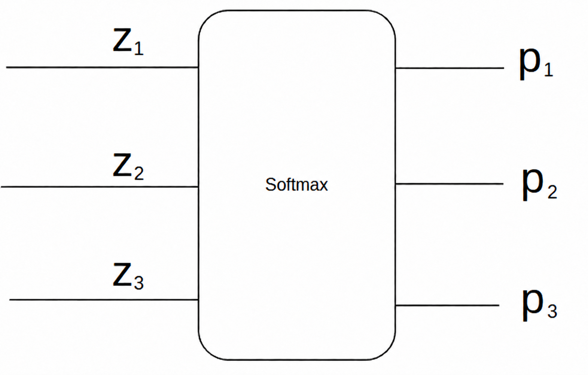
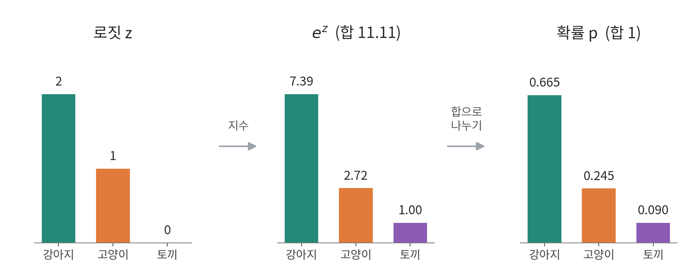
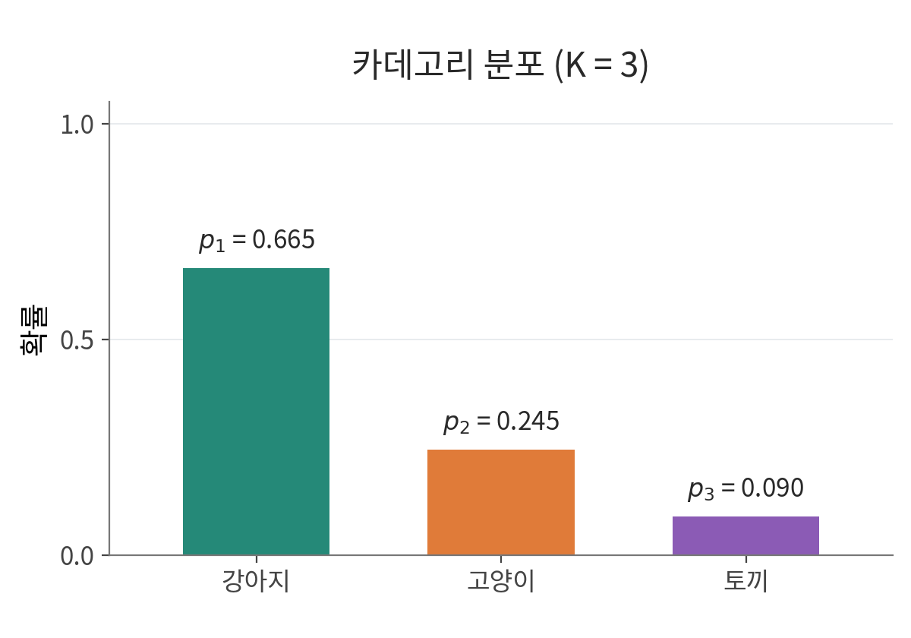
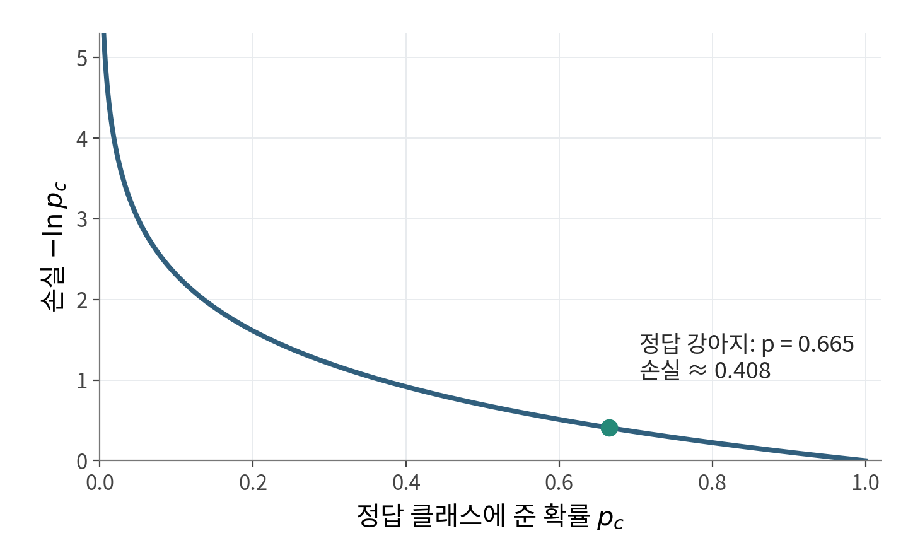
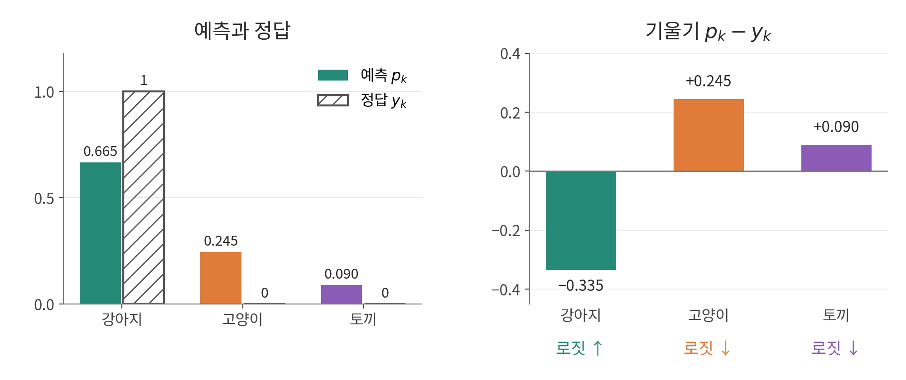

## 1. 다중분류

데이터를 세 개 이상의 클래스 중 하나로 분류하는 것을 다중분류라고 합니다.

예를 들어, 사진을 보고 **[강아지, 고양이, 토끼]** 중 어떤 동물인지 맞히는 작업이 있다고 해봅시다.

컴퓨터는 "이 사진은 고양이야"라는 글자를 그대로 이해하지 못하므로, 정답을 **숫자 목록(벡터)** 형태로 알려주어야 합니다.

이때 가장 널리 쓰이는 방법이 **원-핫 인코딩(One-Hot Encoding)** 입니다. 객관식 답안지에 정답 번호 하나만 칠하듯, 정답 자리만 1로 표시하고 나머지는 전부 0으로 둡니다.

- **강아지 사진일 때:** `[1, 0, 0]`
- **고양이 사진일 때:** `[0, 1, 0]`
- **토끼 사진일 때:** `[0, 0, 1]`

모델은 사진을 보고 클래스마다 점수를 하나씩, 총 3개 계산합니다.

$$\mathbf{z} = [z_1,\ z_2,\ z_3]$$

이 점수를 **로짓(Logit)** 이라고 부릅니다. $z_1, z_2, z_3$은 각각 강아지, 고양이, 토끼의 로짓입니다.

정답은 0과 1로만 이루어져 있지만, 로짓은 `-3.1`, `5.2`처럼 음수도 나오고 크기에도 제한이 없습니다. 범위가 다른 두 값을 바로 비교하면 손실(Loss)을 일관된 기준으로 계산할 수 없습니다.

그래서 로짓을 합이 1인 **각 클래스의 확률**로 바꿔 정답과 같은 기준으로 맞춥니다. 이 변환을 하는 대표적인 함수가 **소프트맥스(Softmax)** 입니다.

## 2. 소프트맥스(Softmax)

softmax는 여러 개의 실수를 받아, 모든 출력이 양수이고 합이 1이 되도록 바꾸는 함수입니다.

각 클래스의 확률 $p_k$는 다음과 같습니다.

$$
p_k=\frac{e^{z_k}}{e^{z_1}+e^{z_2}+e^{z_3}}
$$

$k$는 클래스 번호(1: 강아지, 2: 고양이, 3: 토끼)이고, $e$는 자연상수(약 2.718)입니다.

$e^{z_k}$는 항상 양수이고, 모든 항을 같은 합으로 나누므로 확률의 합은 1입니다. 로짓이 클수록 확률도 큽니다.

로짓이 $[2,\ 1,\ 0]$이면 다음처럼 계산됩니다.

##### 입력값이 자연상수 지수로 쓰는 이유

로짓이 [2,1,0]이라면  $\frac{2} {2 + 1 + 0}$해서 구해도 정상적으로 나옵니다

로짓이 [2,1,-1]면 절대값을 사용해서 구하면 되지않나라고 생각할 수 있습니다. 

$\frac{|2|}{|2| + |1| + |0|}$

절대값을 사용하면 확률은구해지지만 -1이 1로 바뀌어 0인 확률보다 크게 값을 갖게 됩니다. 
여기서 자연상수의 지수로 입력값을 넣게 되면 마이너스여도 값이 양수이면서 0보다 작은 값들이 출력됩니다.

밑이 $e$인 이유는 [시그모이드](/notes/deep-learning/easy-deep-learning-ch04/)와 같습니다. 학습할 때는 손실을 로짓까지 미분하는데, $e^z$는 미분해도 자기 자신이라 계산이 간단합니다.

## 3. 교차 엔트로피(Cross-Entropy)

다중 분류에서도 모델이 안정적으로 수렴하도록 유도하는 손실 함수가 필요합니다.

이진 분류에서는 베르누이 분포 기반으로 BCE(Binary Cross-Entropy)를 유도했습니다.

다중 분류 역시 이 개념의 자연스러운 확장입니다. 정답 클래스가 여러 개 중 단 하나인 상황을 통계학에서는 카테고리 분포(Categorical distribution, 멀티누이 분포)로 모델링합니다.

예를 들어 3개 클래스 [강아지, 고양이, 토끼] 중 정답이 강아지($y = [1, 0, 0]$)이고, 모델의 예측 확률이 $[\hat{y}_1, \hat{y}_2, \hat{y}_3]$라고 해봅시다.

우리가 구하고 싶은 것은 "정답 클래스의 확률($\hat{y}_1$)"뿐입니다. 그런데 컴퓨터나 수학에서는 조건문(if문)을 쓰는 것보다, 모든 클래스의 확률을 한 줄의 곱셈 식으로 깔끔하게 묶어내는 것을 선호합니다.

여기서 지수의 성질($x^1 = x$, $x^0 = 1$)을 활용한 기발한 트릭을 씁니다.

$$\hat{y}_1^{y_1} \times \hat{y}_2^{y_2} \times \hat{y}_3^{y_3}$$

정답 원-핫 벡터($y = [1, 0, 0]$)를 지수에 대입해 보면 어떻게 될까요?

$$\hat{y}_1^1 \times \hat{y}_2^0 \times \hat{y}_3^0 = \hat{y}_1 \times 1 \times 1 = \hat{y}_1$$

오답 클래스들은 지수가 $0$이 되어 전부 $1$로 바뀌어 곱셈에서 사라지고, 오직 **정답 클래스의 확률값($\hat{y}_1$)만 쏙 남게 됩니다.**

#### $\prod$(대문자 파이, Product) 기호로 압축하기

수학에서 더하기를 길게 늘여 쓰기 번거로울 때 $\sum$(시그마)를 쓰듯, **여러 항을 계속 곱할 때는 대문자 파이($\prod$)** 기호를 사용합니다.

- $\sum_{c=1}^K A_c = A_1 + A_2 + \dots + A_K$ (연속 덧셈)
    
- $\prod_{c=1}^K A_c = A_1 \times A_2 \times \dots \times A_K$ (연속 곱셈)
    

따라서 방금 위에서 길게 나열한 곱셈 식을 $\prod$ 기호로 축약하면, 통계학에서 말하는 멀티누이(카테고리) 분포의 확률질량함수가 완성됩니다.

$$P(\mathbf{y} \mid \mathbf{x}; \theta) = \prod_{c=1}^{K} \hat{y}_c^{y_c}$$

정답 클래스 위치만 $y_c = 1$이고 나머지는 $y_c = 0$이므로, 오답 확률 항들은 $x^0 = 1$이 되어 곱셈에서 사라지고 오직 정답 클래스의 예측 확률($\hat{y}_{\text{정답}}$)만 남습니다.

학습의 목표는 이 정답 확률을 최대로 만드는 최대우도추정(MLE)입니다. 

하지만 경사하강법으로 가중치를 최적화하기 위해 음의 부호($-$)를 붙여 손실을 최소화하는 문제(NLL, Negative Log-Likelihood)로 전환합니다.

여기에 로그($\log$)를 씌워 곱을 log + 덧셈으로 변환시킵니다. 

이유는 두 가지입니다.

1. **언더플로우 방지**:
	$0 \sim 1$ 사이의 확률값들을 연속해서 곱할 때 발생하는 부동소수점 언더플로우를 방지합니다.
    
2. **미분의 단순화 및 안정화**: 
    곱셈 연산을 덧셈 연산으로 변환해 역전파 미분을 수치적으로 단순하고 안정하게 만듭니다.
    

이 과정을 통해 유도된 손실 함수가 바로 카테고리컬 교차 엔트로피(Categorical Cross-Entropy, CCE)입니다.

$$\mathcal{L} = -\sum_{c=1}^{K} y_c \log(\hat{y}_c)$$

앞서 구한 Softmax 출력 $[0.665,\ 0.245,\ 0.090]$에서 정답이 강아지이면 정답 벡터는 $[1,\ 0,\ 0]$입니다.

$$\mathcal{L} = -\bigl(1\cdot\ln(0.665) + 0\cdot\ln(0.245) + 0\cdot\ln(0.090)\bigr) = -\ln(0.665) \approx 0.408$$

정답 클래스에 높은 확률을 주었는지 평가하므로, 원-핫 정답값이 $1$인 클래스의 항만 손실에 남습니다.

다만 Softmax 확률은 모든 로짓으로 계산되므로, 학습할 때는 다른 클래스의 로짓도 함께 조정됩니다.

정답 클래스에 부여한 확률이 $0$에 가까워질수록 손실은 무한대($\infty$)로 치솟아 모델에 강력한 페널티를 부여합니다.

### Softmax와 함께 미분하기

앞선 글에서 시그모이드와 BCE를 결합해 미분하면 예측값 - 정답값 $(p - y)$라는 깔끔한 오차 형태만 남았던 것을 확인했습니다.

놀랍게도 **Softmax와 CCE를 결합해 각 로짓($z_k$)에 대해 편미분**해도 동일한 직관이 성립합니다.

$$\frac{\partial \mathcal{L}_{\mathrm{CE}}}{\partial z_k} = p_k - y_k$$
여기서 $p_k = \hat{y}_k = \operatorname{Softmax}(\mathbf{z})_k$는 클래스 $k$에 대한 모델의 예측 확률입니다.

즉, 각 클래스의 로짓에 대한 기울기는 "모델의 예측 확률($p_k$)과 실제 정답($y_k$)의 단순 차이"가 됩니다. 

이 직관적이고 깔끔한 그래디언트가 역전파를 통해 앞선 층으로 전달되면서 신경망의 가중치와 편향을 업데이트합니다.

## 참고 자료

- 혁펜하임, 『이지 딥러닝』, 챕터 4.
- [Dive into Deep Learning · softmax와 교차 엔트로피](https://d2l.ai/chapter_linear-classification/softmax-regression.html).
