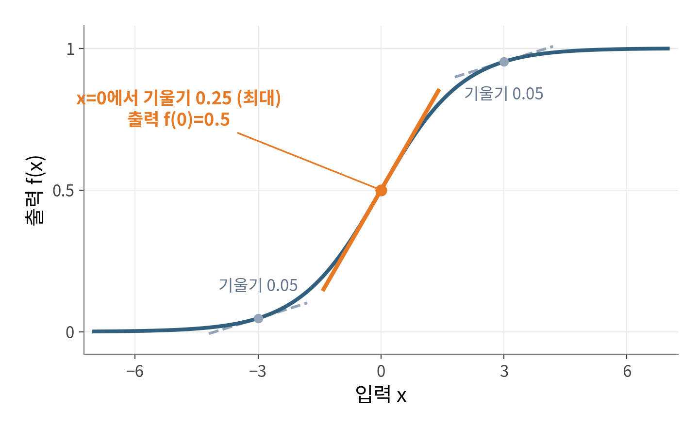
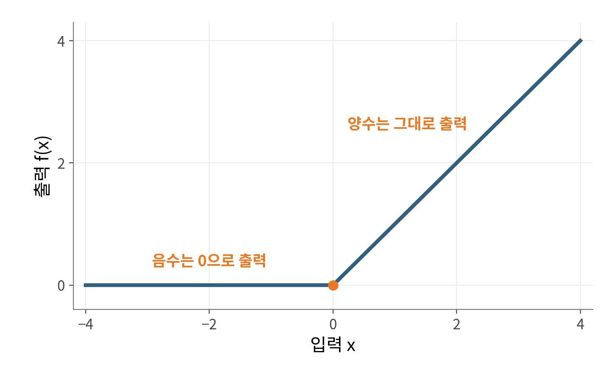
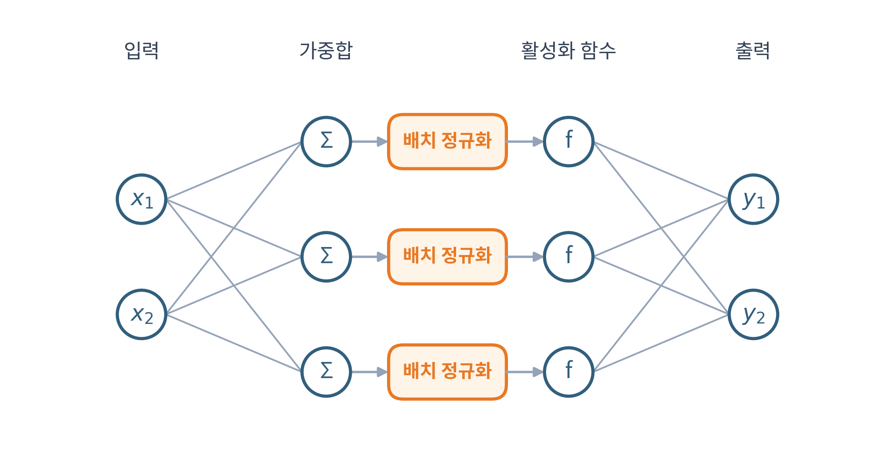
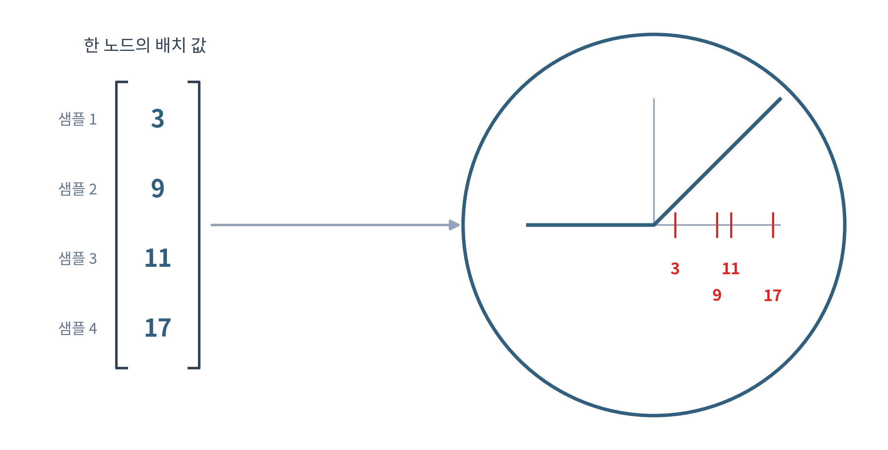
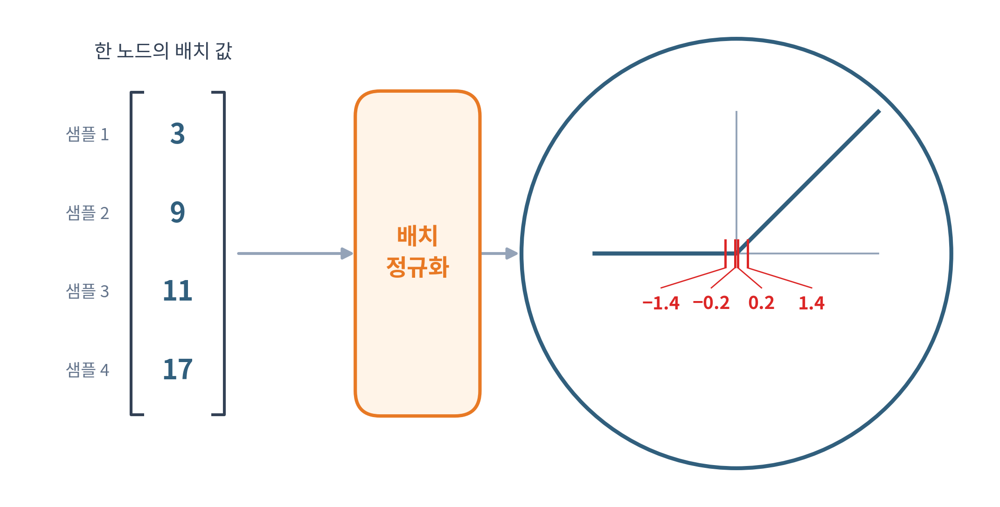
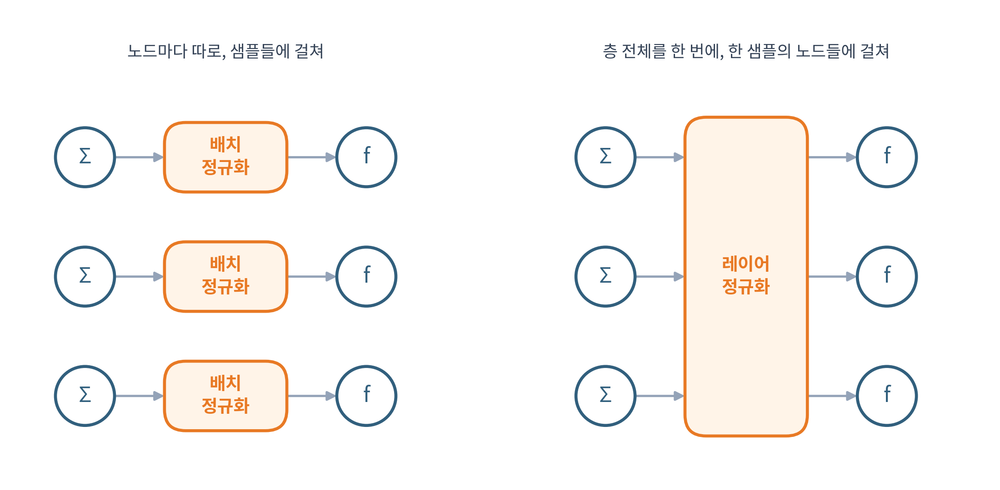
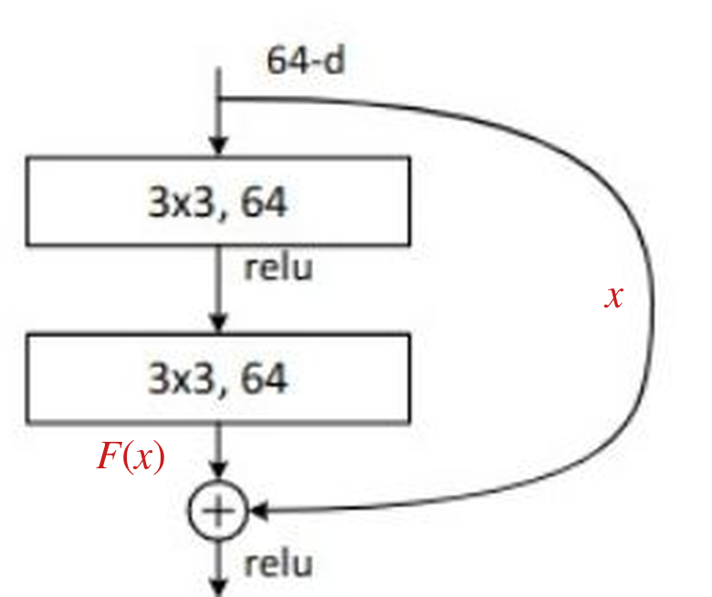

## 1. 기울기 소실이란?

기울기 소실은 역전파로 가중치의 기울기를 구할 때, 층이 많아질수록 입력층에 가까운 가중치의 기울기가 점점 작아져 업데이트가 일어나지 않는 현상입니다. 시그모이드나 tanh함수에서 주로 일어납니다.

## 2. 왜 일어날까

### 시그모이드 미분의 최댓값

역전파를 위해 시그모이드 $f(x)$를 미분하면 다음과 같습니다.

$$f'(x) = f(x)\,(1 - f(x))$$

기울기가 가장 큰 곳은 $x=0$이고, 이때 출력은 $f(0)=0.5$입니다. 그러므로 미분값의 최댓값은 다음과 같습니다.

$$0.5 \times (1 - 0.5) = 0.25$$

역전파에서는 층마다 이 미분값이 곱해집니다. 
가장 큰 값이 0.25이므로, 층이 많아질수록 입력층 쪽 기울기는 0에 가까워지고 업데이트가 잘 일어나지 않습니다.

## 3. 활성화 함수를 바꿔 해결하기

### ReLU

ReLU는 양수는 그대로 출력하고 음수는 0으로 출력하는 함수입니다.

양수 구간의 미분값은 1이고 음수 구간은 0입니다. 그래서 층이 깊어져도 기울기가 잘 전달되고, 모델의 복잡성도 유지됩니다.

### ReLU의 한계

ReLU도 기울기 소실을 완전히 해결하지는 못합니다.

음수를 0으로 만들기 때문에, 입력이 계속 음수인 노드는 출력과 기울기가 모두 0이 되어 더 이상 학습되지 않습니다. 
이를 Dying ReLU라고 합니다. 노드가 적은 층에서는 이 영향이 더 큽니다.

이 문제를 줄이려고 ReLU를 변형한 Leaky ReLU, GELU 등이 나왔습니다. 

자세한 내용은 [3장 활성화 함수](/notes/deep-learning/linear-nonlinear-activations/)에서 다뤘습니다.

## 4. 배치 정규화

여기서 배치는 [미니배치 경사하강법](/notes/deep-learning/easy-deep-learning-ch02/#6-미니배치-경사하강법)의 그 배치입니다. 

이 배치의 값이 모두 양수라면 ReLU는 입력을 그대로 내보내 선형 함수처럼 동작합니다. 
모두 음수라면 출력과 기울기가 0이 됩니다. 가중치가 잘 학습되려면 양수와 음수가 적절히 섞여 들어와야 합니다. 

이 모듈은 노드마다 가중합과 활성화 함수 사이에 둡니다.

노드 하나에 배치로 들어온 값의 평균 $\mu$와 분산 $\sigma^2$를 구하고, 각 값에서 평균을 빼고 표준편차 $\sigma$로 나눕니다.

$$\hat{x}_i = \frac{x_i - \mu}{\sigma}$$

예를 들어 한 노드에 배치로 3, 9, 11, 17이 들어왔다고 해봅시다. 모두 양수라서 ReLU를 통과해도 그대로 나옵니다.

평균과 분산은 다음과 같습니다.

$$\mu = \frac{3+9+11+17}{4} = 10,\qquad \sigma^2 = \frac{(-7)^2+(-1)^2+1^2+7^2}{4} = 25,\qquad \sigma = 5$$

| | 값 1 | 값 2 | 값 3 | 값 4 |
|---|---|---|---|---|
| 입력 $x$ | 3 | 9 | 11 | 17 |
| $x-\mu$ | −7 | −1 | 1 | 7 |
| $\hat{x}=\dfrac{x-\mu}{\sigma}$ | −1.4 | −0.2 | 0.2 | 1.4 |

이렇게 하면 값이 **평균 0, 분산 1**로 맞춰져 0 주변에 고르게 퍼집니다. 
양수와 음수가 섞여 활성화 함수로 들어갑니다. 위 예에서는 ReLU를 통과하면 0, 0, 0.2, 1.4가 되어, 음수는 0이 되고 양수만 남는 비선형 함수로 동작합니다.

### 감마와 베타로 위치를 학습하기

하지만 시그모이드는 구간마다 기울기가 달라서, 평균 0, 분산 1이 항상 최적은 아닙니다. 렐루도 적절한 분산이 최적의 성능을 낸다고 보장할 수 없습니다. 
활성화 함수에 따라 최적의 위치를 미리 알 수 없습니다.

그래서 배치 정규화는 어디로 얼마나 옮길지도 학습합니다. 이를 위해 파라미터 $\gamma$(scale)와 $\beta$(shift)를 둡니다.
r은 얼마나 분산할지와 b는 기준선을 어디로 이동할지는 사용하는 파라미터입니다.

$$y_i = \gamma \cdot \frac{x_i - \mu}{\sigma} + \beta$$

역전파에서 $\gamma$, $\beta$의 편미분도 구해서, 손실을 줄이는 방향으로 위치를 학습합니다.
이렇게 모델이 스스로 구조에 따라 데이터의 분산 을 스스로 조절하여 성능을 향상시킵니다. 

배치 정규화는 활성화 함수 앞에 붙일 때가 많지만 뒤에 붙이기도 합니다.

### 학습할 때와 추론할 때

배치 정규화는 학습과 테스트에서 다르게 동작합니다. 
테스트에서는 배치가 하나라서 평균과 분산이 제대로 계산되지 않을 수 있습니다.

그래서 학습하는 동안 지수 이동 평균(EMA)으로 평균과 분산을 저장해 두고, 테스트에서는 저장한 값을 사용합니다.

### 배치 정규화의 한계

- 배치 크기가 작으면 성능이 나빠지고 편차도 커집니다.
- CNN, MLP 같은 피드포워드 모델에서는 잘 동작하지만, RNN이나 Transformer처럼 시퀀스 데이터를 다루는 모델에서는 성능이 잘 나오지 않습니다. 시점마다 다른 데이터가 들어와 정규화하기 어렵고, 패딩 문제도 생기기 때문입니다.

## 5. 레이어 정규화

배치정규화는 배치 데이터 샘플들간 한 특징들의 표준과 분산을 계산하는 거라면 레이어 정규화는 한 데이터 샘플당 모든 특징을 기반으로 표준과 분산을 계산하는 모듈이다.

레이어 정규화는 주로 시계열 같은 시퀀스 데이터 모델에 적합하고, 배치 크기가 작아도 효과적으로 사용할 수 있습니다.

## 6. 정규화의 부작용과 스킵 커넥션
배치정규화나 레이어정규화를 사용시 오히려 학습 오차가 커지는 현상이 발생합니다.
 ResNet 논문(He 외, 2015)이 이미지 데이터셋 CIFAR-10에서 일반 네트워크 20층과 56층을 비교했습니다. 층이 더 많은 56층이 20층보다
  다음 두 가지에서 모두 나빴습니다.

### 스킵 커넥션

그래서 항등 사상을 스스로 배우기를 기대하는 대신, 구조에 항등 경로를 깔아 둡니다. 이것이 스킵 커넥션(shortcut connection)입니다.
층 몇 개를 묶고, 이 층들을 통과한 값에 입력 $x$를 그대로 더합니다.

아래 그림에서 상자 두 개가 블록 안의 층이고, 오른쪽으로 돌아가는 화살표가 스킵 커넥션입니다. 상자는 이미지용 합성곱 층이지만 여기서는 그냥 층으로 보면 됩니다.

출처: K. He 외, *Deep Residual Learning for Image Recognition*, CVPR 2016, Figure 2

여기서는 마지막 ReLU 전의 덧셈까지 살펴보겠습니다. 두 상자를 지나 ⊕에 들어가기 직전의 값을 $F(x)$라고 하면, ⊕의 출력은 다음과 같습니다.

$$y = F(x) + x$$

예를 들어 입력이 3이고 원하는 출력도 3이라고 해봅시다.

스킵 커넥션이 없으면 층들이 3을 직접 만들어야 합니다. 스킵 커넥션이 있으면 $F(3)$이 0만 내면 $0 + 3 = 3$이 됩니다.

입력 3이 이미 더해지므로, 출력이 3에 가까워지도록 학습하면 $F(3)$은 0에 가까워집니다.

원하는 출력을 $H(x)$라고 하면, $F(x)$가 학습할 목표는 두 값의 차이인 $H(x)-x$입니다. 이 차이를 잔차(residual)라고 합니다.

그래서 이 구조를 쓰는 네트워크를 ResNet(Residual Network)이라고 부릅니다.

### 역전파에서도 이어지는 경로

스킵 커넥션은 역전파에도 경로를 하나 더 만듭니다. 덧셈 지점에 도착한 기울기는 두 경로로 전달되며, 스킵 경로에서는 두 상자 안의 층을 거치지 않고 입력 쪽에 도달합니다.

$x$를 스칼라로 보고 덧셈 지점까지만 미분하면 다음과 같습니다.

$$\frac{dy}{dx} = F'(x) + 1$$

여기서 $1$이 입력을 그대로 더한 경로에서 오는 항입니다.

## 7. 과적합과 방지 방법

과적합을 줄이는 방법에는 다음이 있습니다.

- 모델 경량화
- 조기 종료
- 데이터 증강
- 드롭아웃
- 규제(Regularization)

<!-- TODO: 과적합이란 무엇인지, 방법별로 어떻게 과적합을 줄이는지 -->
