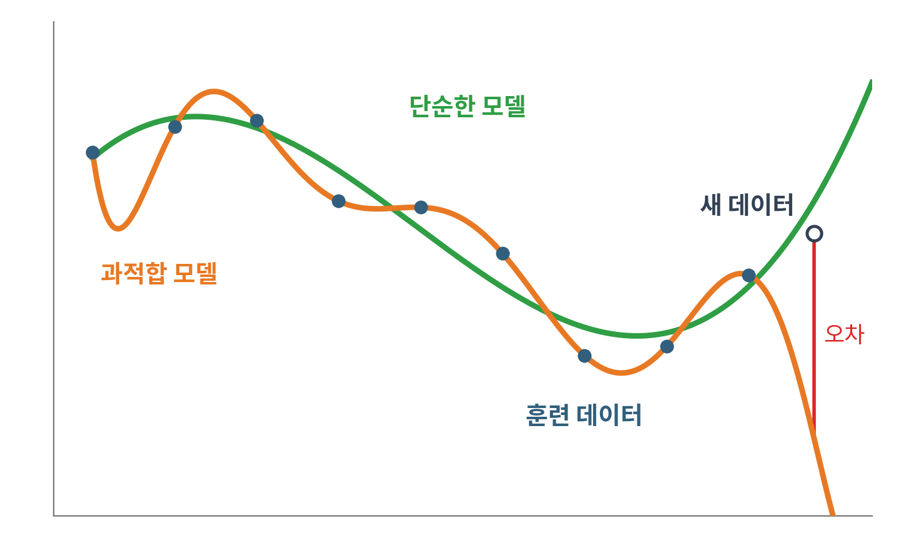
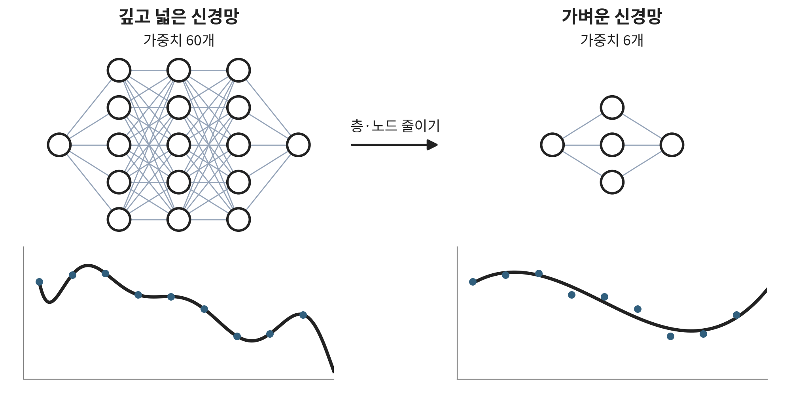
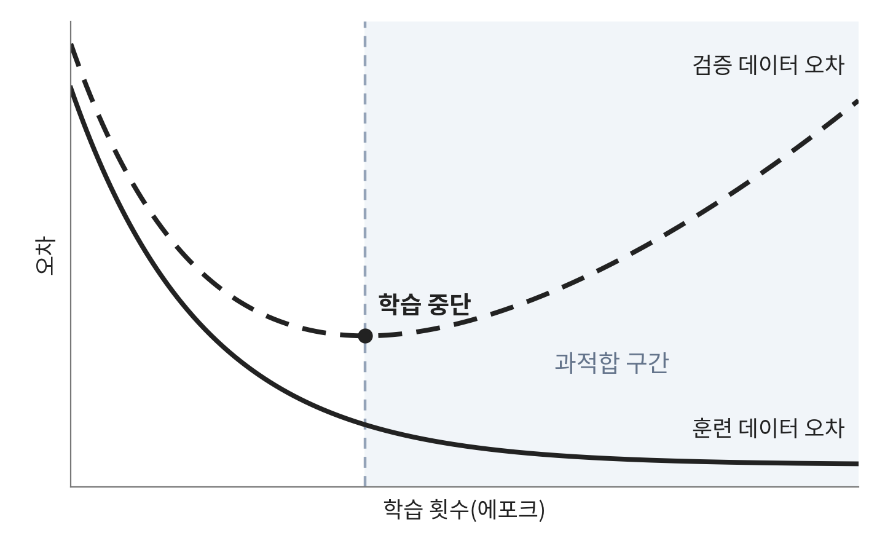
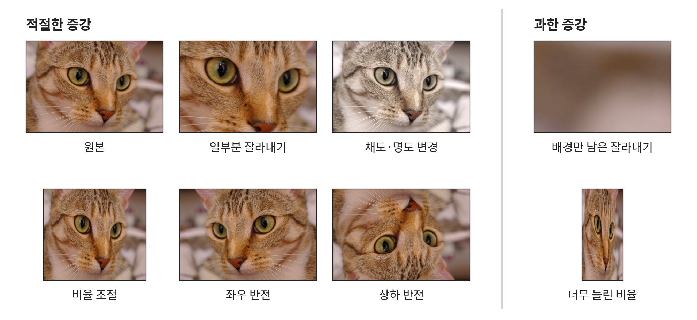
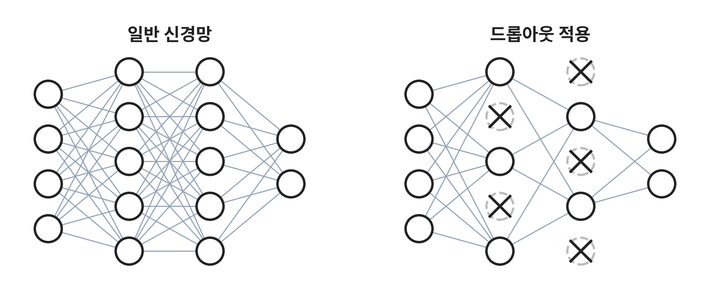
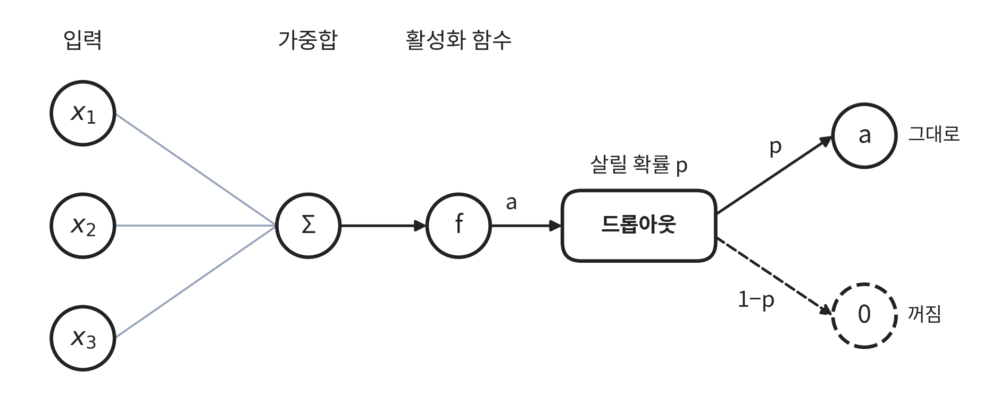

## 1. 과적합이란?

과적합(overfitting)은 모델이 훈련 데이터에만 지나치게 맞춰진 현상입니다. 훈련 데이터에서는 오차가 아주 작게 나오지만, 새로운 데이터에서는 성능이 오히려 크게 떨어집니다.

과적합 모델은 훈련 점을 모두 지나지만, 새 데이터에서는 단순한 모델보다 크게 빗나갑니다.

과적합을 줄이는 방법으로는 모델 경량화, 조기 종료, 데이터 증강, 드롭아웃, 규제가 있습니다.

## 2. 모델 경량화

층 수나 노드 수를 줄여 더 단순한 모델로 만드는 방법입니다. 모델의 복잡도가 줄어들어 과적합을 완화할 수 있습니다.

## 3. 조기 종료(Early Stopping)

조기 종료는 검증 데이터로 가장 좋은 학습 시점을 찾아 과적합을 막는 방법입니다.

모델을 학습시키는 동안 검증 데이터에 대한 오차도 함께 확인합니다. 검증 데이터에 대한 성능이 더 이상 좋아지지 않거나 나빠지면, 그 시점에 학습을 멈춥니다.

실제로는 검증 오차가 한 번 올랐다고 바로 멈추지 않습니다. 정해 둔 에포크 수(patience)만큼 더 지켜봐도 나아지지 않으면 멈추고, 검증 오차가 가장 낮았던 시점의 가중치로 되돌립니다.

## 4. 데이터 증강(Data Augmentation)

데이터 증강은 기존 데이터를 변형해 데이터 수를 늘리는 기법입니다.

데이터가 부족해도 과적합이 일어날 수 있습니다. 데이터를 더 모으기 어려우면 가진 데이터를 변형해서 늘립니다. 고양이 이미지를 분류하는 모델이라면 다음처럼 변형할 수 있습니다.

- 일부분 잘라내기
- 채도, 명도 변경
- 비율 조절
- 상하·좌우 반전

무분별한 데이터 증강은 오히려 학습을 망칠 수 있습니다. 

그림 오른쪽처럼 고양이를 너무 많이 잘라내 배경만 남아도 정답은 여전히 고양이이므로, 모델은 배경을 고양이로 잘못 배웁니다. 

비율을 너무 많이 늘리면 다른 동물로 잘못 인식할 수 있습니다.

그래서 데이터 증강은 목적에 맞게 적절히 활용해야 합니다.

## 5. 드롭아웃(Dropout)

드롭아웃은 학습 과정에서 일부 노드를 무작위로 비활성화하는 방법입니다.

드롭아웃은 원하는 층의 노드 출력값에 배치합니다. 노드를 살릴 확률 p(하이퍼파라미터)를 정해 두면, 데이터가 이 층을 지날 때마다 각 노드의 활성 여부가 확률에 따라 무작위로 바뀝니다.

예를 들어 미니배치 크기가 4라면, 데이터 4개는 각각 다른 노드가 꺼진 신경망을 지나갑니다. 

이렇게 나온 출력값으로 손실 4개를 구해 평균을 내고, 이 값으로 기울기를 계산해 파라미터를 업데이트합니다.

드롭아웃은 학습할 때와 테스트할 때 다르게 동작합니다. 학습할 때는 노드를 확률 p로만 살리지만, 테스트할 때는 모든 노드를 사용합니다.

대신 테스트할 때는 노드 출력값에 p를 곱합니다. 학습 때 각 노드는 평균적으로 p의 비율로만 켜져 있었으므로, 출력의 크기를 학습 때와 맞추기 위해서입니다.

이렇게 학습하면 노드들이 특정 노드에 기대지 못하고 각자 쓸모 있는 특징을 배우게 됩니다. 

그래서 네트워크 하나가 더 다양한 특징을 추출할 수 있습니다.

## 6. 규제(Regularization)

규제는 학습할 때 손실 함수에 파라미터 크기를 벌점(penalty)으로 더하는 방법입니다. 

파라미터가 지나치게 커지는 것을 막아, 훈련 데이터의 사소한 노이즈까지 맞추는 과적합을 줄입니다. 

이름이 비슷하지만 [7장의 배치 정규화](/notes/deep-learning/easy-deep-learning-ch06/#4-배치-정규화)(normalization)와는 다른 개념입니다.

$$\text{Total Loss} = \text{Loss}_{\text{기존}} + \frac{\lambda}{p} \lVert w \rVert_p^p$$

- $w$: 신경망의 모든 가중치를 모은 벡터
- $\lVert \cdot \rVert_p$: $L_p$ 노름($L_p$-norm)
- $\lambda$: 규제 강도를 조절하는 하이퍼파라미터
- $p$: 규제 차수
    - $p=1$: **L1 규제(Lasso)** $\rightarrow \text{Loss} + \lambda \lVert w \rVert_1$
    - $p=2$: **L2 규제(Ridge, Weight Decay)** $\rightarrow \text{Loss} + \frac{\lambda}{2} \lVert w \rVert_2^2$

$\lambda$가 0이면 $\text{Loss} + 0 \times \lVert w \rVert_2^2 = \text{Loss}$가 되어 규제가 적용되지 않습니다.

반대로 $\lambda$가 매우 크면 원래 손실보다 파라미터 크기를 줄이는 데 집중하게 되어, 이번에는 데이터를 충분히 따라가지 못합니다.

### 왜 파라미터 크기를 줄일까

파라미터가 클수록 입력이 조금만 바뀌어도 출력이 크게 바뀝니다. 

그래서 1절 그림의 과적합 곡선처럼 그래프의 굴곡이 심해지고, 더 복잡한 비선형 관계를 표현하게 됩니다. 

그래서 손실과 함께 파라미터 크기도 고려해 조절합니다.
