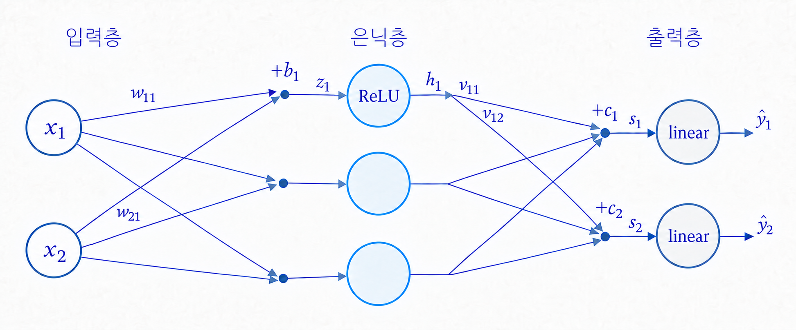
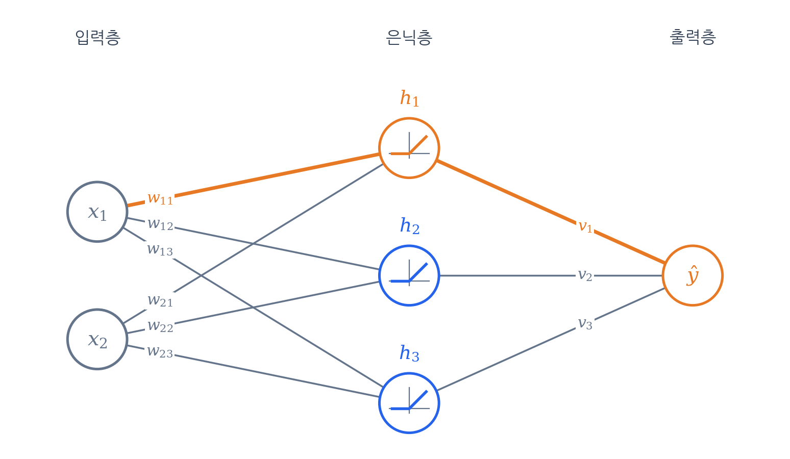
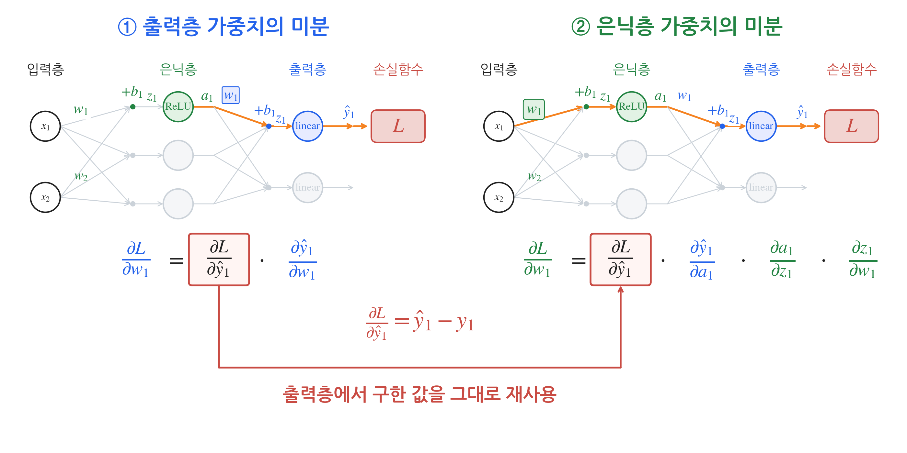

## 역전파 알고리즘

딥러닝 학습은 결국 <strong>"오차를 줄이도록 모든 가중치를 알맞게 조절하는 일"</strong>입니다.
이를 위해 각 가중치가 오차에 얼마나 영향을 미쳤는지(그래디언트)를 효율적으로 구해내는 핵심 알고리즘이 바로 <strong>역전파(Backpropagation)</strong>입니다.

마지막 출력층은 정답과 비교해 얼마나 틀렸는지 바로 알 수 있습니다.
하지만 중간에 낀 **은닉층은 정답 라벨이 없습니다.** 개별 은닉 노드가 몇을 내뱉어야 정답인지 중간 기준이 없는데, 최종 오차의 책임을 어떻게 물을 수 있을까요?

해답은 단순합니다. <strong>"도미노를 거꾸로 짚어가는 것"</strong>입니다.
은닉 노드가 변하면 $\to$ 출력이 변하고 $\to$ 결국 최종 오차가 변합니다.
역전파는 이 인과관계를 미분의 <strong>연쇄 법칙(Chain Rule)</strong>으로 엮어, 오차가 발생한 맨 뒤(손실)에서부터 거꾸로 계산해 각 가중치의 기여도를 찾아냅니다.

뒤쪽에서 구한 계산 결과는 앞쪽 노드들이 **함께 나눠 씁니다.** 같은 계산을 반복하지 않는 것이 역전파의 핵심입니다.

## 그림에서 계산 경로 따라가기

아래 신경망에서 은닉층의 값은 초록색, 출력층의 값은 파란색으로 표시했습니다. 먼저 입력에서 예측값까지 따라가 보겠습니다.

- 가중치: $w$
- 편향: $b$
- 활성화 노드 입력값: $z$
- 활성화 노드 출력값: $a$

### 입력에서 예측값까지

아래 그림의 주황색 경로를 보겠습니다. 첫 입력이 은닉 노드 하나를 지나 첫 번째 예측값에 도달하는 경로입니다.

1. 입력층: 입력 x₁에 가중치 w₁을 곱하고, 다른 입력의 가중합과 편향 b₁을 더합니다.
2. 은닉층: 선형 변환 결과 z₁에 ReLU를 적용하여 a₁을 얻습니다.
3. 출력층: a₁에 출력층 가중치 w₁을 곱하고, 다른 은닉 노드의 가중합과 편향 b₁을 더합니다. 선형 활성화 함수는 계산한 값을 그대로 예측값 ŷ₁로 내보냅니다.

이처럼 입력에서 출력으로 계산하는 과정을 **순전파**라고 합니다.

## 손실에서 거꾸로 미분하기

이제 파란색 가중치와 초록색 가중치를 각각 바꿀 때, 손실이 얼마나 변하는지 구하겠습니다. 그림에서 둘 다 $w_1$로 표시되어 있으므로 색으로 구분합니다.

설명을 단순하게 하려고 첫 번째 출력의 제곱 오차만 사용합니다. 미분할 때 지수 2가 상쇄되도록 $\frac12$을 곱합니다.

$$
L=\frac12(\textcolor{#2563EB}{\hat y_1}-y_1)^2
$$

출력이 여러 개면 각 출력을 거치는 경로의 미분을 모두 더합니다.

### 출력층 가중치의 미분

$\textcolor{#2563EB}{w_1}$의 기울기를 먼저 계산합니다. 연쇄 법칙으로 두 개의 미분으로 나눕니다.

$$
\frac{\partial L}{\partial \textcolor{#2563EB}{w_1}}
= \underbrace{\frac{\partial L}{\partial \textcolor{#2563EB}{\hat y_1}}}_{(1)}
\cdot \underbrace{\frac{\partial \textcolor{#2563EB}{\hat y_1}}{\partial \textcolor{#2563EB}{w_1}}}_{(2)}
$$

#### (1) 손실을 예측값으로 미분

지수 2가 앞으로 내려와 $\frac12$과 상쇄되고, 예측값과 정답의 차이만 남습니다.

$$
\begin{gathered}
L=\frac12(\textcolor{#2563EB}{\hat y_1}-y_1)^2 \\[6pt]
\frac{\partial L}{\partial \textcolor{#2563EB}{\hat y_1}} = \textcolor{#2563EB}{\hat y_1} - y_1
\end{gathered}
$$

#### (2) 예측값을 가중치로 미분

$\textcolor{#2563EB}{w_1}$에 곱해진 $\textcolor{#238443}{a_1}$만 남고, 나머지 항은 $\textcolor{#2563EB}{w_1}$과 무관한 상수라서 0이 됩니다.

$$
\begin{gathered}
\textcolor{#2563EB}{\hat y_1} = \textcolor{#2563EB}{w_1}\textcolor{#238443}{a_1} + (\text{다른 은닉 노드 항}) + \textcolor{#2563EB}{b_1} \\[6pt]
\frac{\partial \textcolor{#2563EB}{\hat y_1}}{\partial \textcolor{#2563EB}{w_1}} = \textcolor{#238443}{a_1}
\end{gathered}
$$

#### (3) 결과

$$
\frac{\partial L}{\partial \textcolor{#2563EB}{w_1}}
= \underbrace{(\textcolor{#2563EB}{\hat y_1} - y_1)}_{(1)}
\, \underbrace{\textcolor{#238443}{a_1}}_{(2)}
$$

예를 들어 예측값이 3, 정답이 1, 이 가중치에 연결된 은닉 노드의 출력이 2라면 다음과 같습니다.

$$
\frac{\partial L}{\partial \textcolor{#2563EB}{w_1}}=(3-1)\times2=4
$$

기울기가 양수이므로, 경사하강법은 이 가중치를 줄이는 방향으로 갱신합니다.

### 은닉층 가중치의 미분

$\textcolor{#238443}{w_1}$은 출력층을 지나 손실에 영향을 주므로, 연쇄 법칙으로 네 개의 미분으로 나눕니다.

$$
\begin{aligned}
\frac{\partial L}{\partial \textcolor{#238443}{w_1}}
&= \underbrace{\frac{\partial L}{\partial \textcolor{#2563EB}{\hat y_1}}}_{(1)}
\cdot \underbrace{\frac{\partial \textcolor{#2563EB}{\hat y_1}}{\partial \textcolor{#238443}{a_1}}}_{(2)} \\[6pt]
&\quad\cdot \underbrace{\frac{\partial \textcolor{#238443}{a_1}}{\partial \textcolor{#238443}{z_1}}}_{(3)}
\cdot \underbrace{\frac{\partial \textcolor{#238443}{z_1}}{\partial \textcolor{#238443}{w_1}}}_{(4)}
\end{aligned}
$$

#### (1) 손실을 예측값으로 미분

출력층에서 구한 값과 같습니다: $\textcolor{#2563EB}{\hat y_1} - y_1$

#### (2) 예측값을 은닉 노드 출력으로 미분

같은 출력 노드 식을 이번에는 $\textcolor{#238443}{a_1}$로 미분합니다. $\textcolor{#238443}{a_1}$에 곱해진 $\textcolor{#2563EB}{w_1}$만 남습니다.

$$
\begin{gathered}
\textcolor{#2563EB}{\hat y_1} = \textcolor{#2563EB}{w_1}\textcolor{#238443}{a_1} + (\text{다른 은닉 노드 항}) + \textcolor{#2563EB}{b_1} \\[6pt]
\frac{\partial \textcolor{#2563EB}{\hat y_1}}{\partial \textcolor{#238443}{a_1}} = \textcolor{#2563EB}{w_1}
\end{gathered}
$$

#### (3) ReLU 미분

$\textcolor{#238443}{z_1}>0$이면 $\textcolor{#238443}{a_1}=\textcolor{#238443}{z_1}$라서 기울기가 1이고, 아니면 $\textcolor{#238443}{a_1}=0$으로 고정이라 기울기가 0입니다. $\textcolor{#238443}{z_1}=0$에서는 미분이 정의되지 않아 보통 0으로 둡니다.

$$
\begin{gathered}
\textcolor{#238443}{a_1} = \max(0, \textcolor{#238443}{z_1}) \\[6pt]
\frac{\partial \textcolor{#238443}{a_1}}{\partial \textcolor{#238443}{z_1}} = \operatorname{ReLU}'(\textcolor{#238443}{z_1}) =
\begin{cases}
1 & (\textcolor{#238443}{z_1} > 0) \\
0 & (\textcolor{#238443}{z_1} \le 0)
\end{cases}
\end{gathered}
$$

#### (4) 은닉 노드 입력을 가중치로 미분

$\textcolor{#238443}{w_1}$에 곱해진 $x_1$만 남습니다.

$$
\begin{gathered}
\textcolor{#238443}{z_1} = \textcolor{#238443}{w_1}x_1 + \textcolor{#238443}{w_2}x_2 + \textcolor{#238443}{b_1} \\[6pt]
\frac{\partial \textcolor{#238443}{z_1}}{\partial \textcolor{#238443}{w_1}} = x_1
\end{gathered}
$$

#### (5) 결과

$$
\frac{\partial L}{\partial \textcolor{#238443}{w_1}}
= \underbrace{(\textcolor{#2563EB}{\hat y_1} - y_1)}_{(1)}
\, \underbrace{\textcolor{#2563EB}{w_1}}_{(2)}
\, \underbrace{\operatorname{ReLU}'(\textcolor{#238443}{z_1})}_{(3)}
\, \underbrace{x_1}_{(4)}
$$

## 계산한 값 재사용하기

아래 그림의 빨간 상자를 보겠습니다. 출력층에서 구한 예측 오차가 은닉층의 미분에도 그대로 들어 있습니다.

따라서 손실 함수부터 다시 미분할 필요 없이, 파란색 $\textcolor{#2563EB}{w_1}$의 미분을 구할 때 저장한 $\textcolor{#2563EB}{\hat y_1}-y_1$에 나머지 미분값을 곱하면 됩니다.
역전파는 이처럼 뒤쪽 층에서 구한 미분값을 앞쪽 층으로 넘기고, 각 층에서는 그 층의 미분만 곱해 계산을 이어갑니다.
층이 더 많아도 같은 과정이 입력층 방향으로 반복됩니다.

미분식에 들어가는 값 중 일부는 순전파에서 이미 계산했습니다.

- $\textcolor{#2563EB}{\hat y_1}$: 순전파의 최종 출력입니다.
- $\textcolor{#238443}{a_1}$: 파란색 $\textcolor{#2563EB}{w_1}$의 기울기 $(\textcolor{#2563EB}{\hat y_1}-y_1)\textcolor{#238443}{a_1}$에 곱해지는 값으로, 순전파에서 구한 은닉 노드의 출력입니다.
- $\operatorname{ReLU}'(\textcolor{#238443}{z_1})$: 순전파에서 구한 $\textcolor{#238443}{z_1}$의 부호로 정해집니다.

그래서 순전파를 할 때 $\textcolor{#238443}{z_1}$, $\textcolor{#238443}{a_1}$, $\textcolor{#2563EB}{\hat y_1}$을 저장해 두고, 역전파에서는 꺼내 쓰기만 합니다.

## 참고 자료

- 혁펜하임, 『이지 딥러닝』, 챕터 3.
- [Stanford CS231n · 연쇄 법칙과 역전파](https://cs231n.github.io/optimization-2/).
