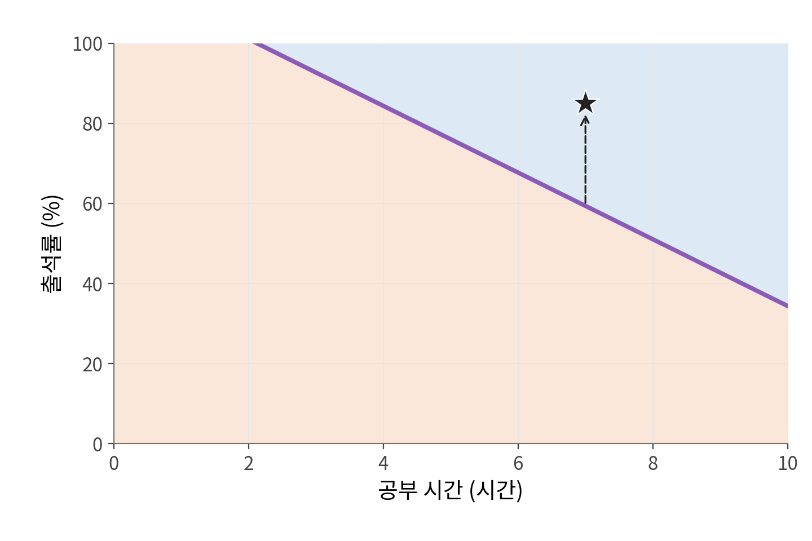
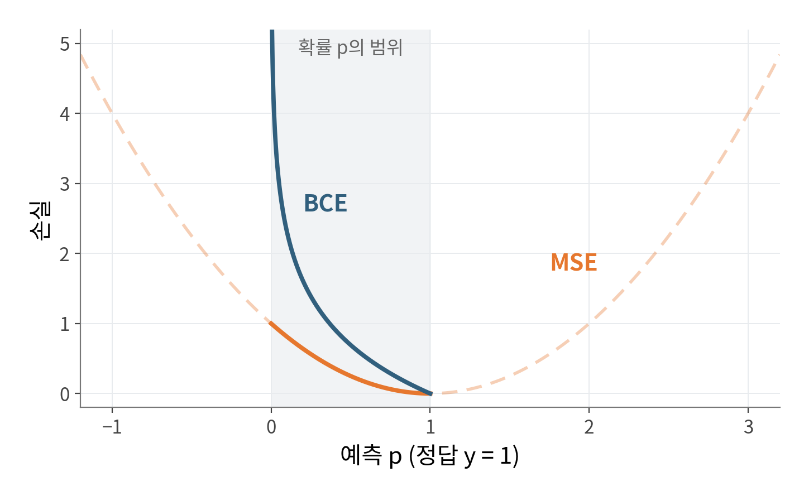

## 1. 이진분류

**이진분류**(Binary Classification)는 입력되는 데이터를 두 클래스로 나누는 작업입니다.

세 개 이상으로 나누는 것은 다중분류라고 합니다.

이진분류 활용 예

- 스팸 / 정상 메일 구분
- 질병 진단
- 불량품 검사
- 시험 합격 예측

## 2. 이진분류 과정

시험 공부 시간과 출석률 데이터로 학생 의 의 시험 합격, 불합격으로 분류해보는 작업으로 예를 들어 살펴보겠습니다.

### 데이터 수집

먼저 학생 6명의 데이터, 정답 데이터를 수집했다고 가정해봅니다.

### 모델 설계

**유닛 스텝 함수**(계단 함수)를 사용하는 퍼셉트론을 사용하겠습니다. $x_1$에는 공부 시간, $x_2$에는 출석률이 입력됩니다.

 두가중치와 바이어스 $z=w_1x_1+w_2x_2+b$를 계산해, 유닛 스텝 함수에 들어갈 값 z가 $z>0$이면 1을 출력하고 $z\leq0$이면 0을 출력합니다.

이걸 그래프 방정식으로 가로축을 $x_1$, 세로축을 $x_2$로 놓고 $z=0$을 $x_2$에 대해 정리하면 다음 직선이 됩니다.

$$
x_2=-\frac{w_1}{w_2}x_1-\frac{b}{w_2}
$$

$w_2>0$인 경우, 직선보다 위쪽은 1, 경계선과 아래쪽은 0으로 분류합니다.

이처럼 두 부류를 나누는 선을 분류 경계선이라고 합니다. 
데이터의 특징들을 **선형 결합(곧은 직선이나 평면 형태)** 하여 경계를 정하는 분류를 선형 분류라고 합니다.

### 모델 학습

공부 시간과 출석률을 모델에 넣어 예측값을 구하고, 실제 합격 여부(정답 라벨)와 비교합니다. 이때 잘못 분류된 학생의 **예측 점수($z$)가 정답 방향으로 움직이도록** 가중치와 편향을 조금씩 조정합니다.

이 과정을 반복하면서 두 부류를 가장 잘 가르는 최적의 경계선을 찾아갑니다.

### 모델 테스트

학습에 쓰이지 않은 새로운 학생의 데이터를 입력하면 모델은 다시 점수 $z$를 계산합니다. 

이 점수가 경계선 기준선($z = 0$)보다 위쪽(양수)에 놓이면 '합격', 아래쪽(음수)에 놓이면 '불합격'으로 판단합니다.

### 유닛 스텝 함수의 한계

**1. 경사하강법을 통한 학습 불가**

- $z \neq 0$ 구간: 미분값이 0인 완전한 평지이므로 역전파 시 기울기가 소실되어 가중치가 전혀 갱신되지 않습니다.

- $z = 0$ 구간: 불연속 지점으로 수학적 미분이 불가능합니다.
- 
    

**2. 연속적인 확신도(Confidence) 부재 및 일반화 한계**

- 경계 바로 옆($z=0.01$)과 경계에서 멀리 떨어진($z=10$) 샘플을 모두 동일하게 1로 출력하여 예측의 불확실성을 반영하지 못합니다.
    
- 훈련 데이터가 분리되는 순간 학습이 종료되기 때문에, 결정 경계가 데이터에 바짝 붙어 마진(Margin)이 작아져도 보정하지 않아 테스트 데이터에 대한 일반화 성능이 떨어집니다.

이런 유닛 스텝 함수의 한계를 개선하기 위해 시그모이드 함수를 사용합니다.

## 3. 시그모이드(Sigmoid)

**시그모이드**(Sigmoid)는 입력되는 값 $z$를 0과 1 사이의 확률 $p$로 바꿔주는 활성화 함수입니다.

시그모이드의 자세한 특징은 [3장 「활성화 함수」의 시그모이드 설명](/notes/deep-learning/linear-nonlinear-activations/#2-시그모이드sigmoid)에서 자세히 다룹니다.

시그모이드 함수 수식
$$
출력값 p=\sigma(z)=\frac{1}{1+e^{-z}}
$$

### 시그모이드의 특징

**시그모이드 함수를 쓰는 핵심 이유**

시그모이드는 단순한 O/X(0 또는 1) 대신 **0과 1 사이의 연속적인 '확률'** 을 출력합니다 
($z=0.01 \to 50.2\%$, $z=10 \to 99.9\%$). 

이렇게 확률 형태로 변환함으로써 두 가지 결정적인 이점을 얻습니다.

**1. 문제 상황에 맞춰 합격 기준(임계값)을 유연하게 조절할 수 있습니다.**

단순히 0.5(50%)를 기준으로 삼는 데 그치지 않고, 판정을 더 엄격하게 하고 싶다면 기준을 0.8로 올리는 등 비즈니스나 도메인 목적에 맞게 의사결정 기준선을 직접 통제할 수 있습니다.

**2. 전 구간이 미분 가능해 경사하강법으로 학습할 수 있습니다.**

계단 함수처럼 기울기가 0이 되어버리는 평지 구간이 없습니다. 
출력이 매끄럽게 이어져 있으므로 오차를 기반으로 가중치와 편향을 정답 방향으로 정확하게 업데이트할 수 있습니다.

 실제 그래프에서 두 모델  데이터 6개을 모두 맞게 나누지만, 시그모이드 모델은 경계에 가까운 학생의 확신도까지 높이려 하므로 경계가 경계선이 훨씬 여유롭고 안정적인 위치에 놓입니다. 
 
## 4. 손실 함수

회귀에서는 손실 함수로 주로 MAE나 MSE를 사용하지만, 이진분류에서는 **이진 교차 엔트로피**(Binary Cross-Entropy, BCE)를 주로 사용합니다.

BCE를 사용하는 이유는 두 가지입니다.

1. 데이터 분포 관점

2. 틀린 예측에 주는 손실의 크기

### 1. 데이터 분포 관점

#### 베르누이 분포

이진분류의 정답은 합격(1) 아니면 불합격(0), 두 가지뿐입니다. 

이렇게 결과가 두 가지뿐인 시행의 데이터들의 분포를 **베르누이 분포**라고 합니다. (수학자 야코프 베르누이의 이름을 땄습니다.)

1이 나올 확률을 $p$라고 하면, 0이 나올 확률은 $1-p$입니다. 

컴퓨터 프로그래밍이라면 조건문(`if (y == 1) return p; else return 1-p;`)으로 나눠 쓰면 되지만, 수식에서는 지수 자리에 $y$와 $1-y$를 올려 한 줄로 표현합니다.

$$
P(Y=y)=p^y(1-p)^{1-y}
$$

- $y=1$일 때: $p^1(1-p)^0=p$

- $y=0$일 때: $p^0(1-p)^1=1-p$

이렇게 한 식으로 써 두면, 데이터가 여러 개일 때 모든 데이터의 확률을 하나의 곱으로 쓸 수 있습니다.

#### 우도와 최대우도추정

방금 본 식은 $p$(확률)을 미리 알고 있을 때 데이터가 나올 확률을 구하는 식이었습니다.

하지만 **머신러닝에서는 반대 상황**을 마주합니다. 수집한 데이터(합격/불합격 결과)는 이미 손에 쥐고 있지만, 정답을 만들어낸 진짜 확률 $p$는 모릅니다.

그래서 관점을 뒤집어야 합니다. **"이미 일어난 데이터를 바탕으로, 어떤 $p$가 이 결과를 가장 그럴듯하게 설명할까?"** 를 거꾸로 추적하는 것입니다. 

이렇게 '결과를 고정하고 파라미터의 관점에서 본 확률'을 **우도(Likelihood, 그럴듯함의 정도)**라고 부릅니다

앞면이 나올 확률이 $p$인 동전을 10번 던져 앞면이 7번, 뒷면이 3번 나왔다고 해 봅시다. 

각 던지기는 서로 영향을 주지 않으므로(독립 시행), 이 결과가 관측될 우도는 각 확률을 모두 곱한 $p^7(1-p)^3$입니다. $p$ 후보 두 개의 우도를 비교해 보겠습니다.

- **$p = 0.5$일 때:** $(0.5)^7 \times (0.5)^3 \approx \mathbf{0.00098}$
- **$p = 0.7$일 때:** $(0.7)^7 \times (0.3)^3 \approx \mathbf{0.00222}$

$p=0.7$일 때 우도가 더 큽니다. 즉, 관측된 데이터를 가장 잘 설명하는 값은 $p=0.7$입니다. 

이렇게 우도가 가장 커지는 최적의 파라미터를 찾는 방법을 최대우도추정(Maximum Likelihood Estimation, MLE)이라고 합니다

#### 여러 데이터들의 우도를 구할때

동전 던지기는 모든 시행에서 동일한 $p$를 공유합니다. 하지만 실제 이진분류(예: 학생들의 시험 합격 예측)에서는 학생마다 공부 시간이나 환경이 다르므로, 합격 확률도 학생마다 $p_1, p_2, \dots$처럼 제각각 다릅니다.

머신러닝 모델은 각 학생의 입력 특징에 가중치($W$)와 편향($b$)을 적용한 뒤, 시그모이드 함수를 거쳐 이 $p_i$를 예측합니다. 각 학생의 결과가 서로 독립이라고 가정하면, 전체 데이터셋에 대한 총 우도는 개별 확률의 곱이 됩니다. 학생 6명이라면 다음과 같습니다.

$$
\left[p_1^{y_1}(1-p_1)^{1-y_1}\right]
\times\cdots\times
\left[p_6^{y_6}(1-p_6)^{1-y_6}\right]
$$

결국 모델 학습의 목표는 **이 총 우도를 최대로 만드는 최적의 가중치($W$)와 편향($b$)을 찾는 것**입니다.

#### 왜 로그를 씌울까?

데이터가 많아지면 확률을 계속 곱한 값이 너무 작아져, 컴퓨터가 0으로 처리하는 **언더플로**(underflow)가 생길 수 있습니다. 

그래서 곱에 자연로그를 씌웁니다. 로그는 단조증가함수이므로 최대값을 만드는 가중치와 편향의 위치는 바뀌지 않습니다. 

로그를 씌우게 되면 곱이 덧셈으로 바뀌고 log가 곱해집니다. 

$$
\left[y_1\ln p_1+(1-y_1)\ln(1-p_1)\right]
+\cdots+
\left[y_6\ln p_6+(1-y_6)\ln(1-p_6)\right]
$$

#### 마이너스 부호를 붙여 손실 함수로 변환

경사하강법은 값을 줄이는(최소화하는) 알고리즘입니다. 따라서 우도를 '최대화'하는 문제를 손실을 '최소화'하는 문제로 바꾸기 위해 마이너스($-$)를 붙입니다.

여기에 전체 데이터 개수 $N$으로 나누어 평균을 내면, 우리가 사용하는 **BCE 손실 함수**가 완성됩니다.

$$
L_{\mathrm{BCE}}=-\frac{1}{N}\sum_{i=1}^{N}
\left[y_i\ln p_i+(1-y_i)\ln(1-p_i)\right]
$$

#### 2. 틀린 예측에 주는 손실의 크기

정답이 1(합격)일 때, 예측값 $p$가 틀릴수록 두 손실이 어떻게 변하는지 비교해 보겠습니다.

- **MSE:** 정답($p=1$)에서 0이 되는 완만한 곡선입니다. 확률 $p$는 0과 1 사이에만 있으므로, 완전히 엉터리로 예측($p \to 0$)해도 **손실은 최대 1**에 그칩니다. 오답에 주는 벌점이 너무 작아서, 크게 틀렸을 때도 모델이 느긋하게 반응합니다.
    
- **BCE:** 정답과 반대로 예측($p \to 0$)할수록 **손실이 무한대($\infty$)로 치솟습니다.** 완전히 잘못 예측했을 때 가차 없이 큰 페널티를 주기 때문에, 모델이 즉각적이고 강하게 가중치를 수정하여 오답 구간을 빠르게 탈출합니다.

확률을 다루는 이진분류에서는 **틀린 예측에 확실한 페널티를 주어 빠르고 안정적으로 학습시키는 BCE**가 훨씬 적합합니다.

## 참고 자료

- 혁펜하임, 『이지 딥러닝』, 챕터 4.
- [Stanford CS231n · 활성화 함수](https://cs231n.github.io/neural-networks-1/). 시그모이드 곡선 그림 출처.
- [Dive into Deep Learning · 최대우도추정](https://d2l.ai/chapter_appendix-mathematics-for-deep-learning/maximum-likelihood.html).
- [Dive into Deep Learning · 선형 회귀와 제곱 손실](https://d2l.ai/chapter_linear-regression/linear-regression.html).
