## 1. 이진분류

이진 분류(Binary Classification)는 주어진 입력 데이터에 대해 'O냐 X냐'처럼 두 가지 선택지 중 하나를 판별하는 머신러닝 작업입니다. 세 개 이상으로 나누는 것은 다중분류라고 합니다.

이진분류 활용 예
- 스팸 / 정상 메일 구분
- 질병 진단
- 불량품 검사
- 시험 합격 예측

## 2. 이진분류 과정

시험 공부 시간과 출석률 데이터로 학생의 시험 합격, 불합격으로 분류해보는 작업으로 예를 들어 살펴보겠습니다.

### 데이터 수집

먼저 학습에 필요한 데이터를 수집합니다. 학생 6명의 데이터, 정답 데이터를 수집했다고 가정해봅니다.

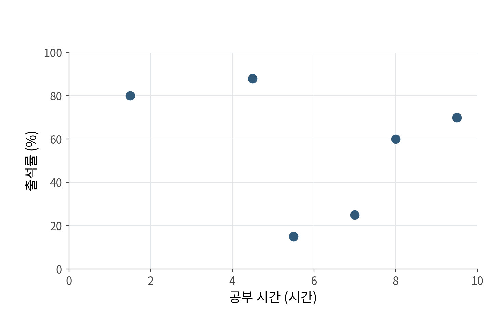

### 모델 설계

모델을 **유닛 스텝 함수**(계단 함수)가 활성화 함수인  퍼셉트론을 사용해보겠습니다. 입력노드 $x_1$에는 공부 시간, $x_2$에는 출석률이 입력됩니다.

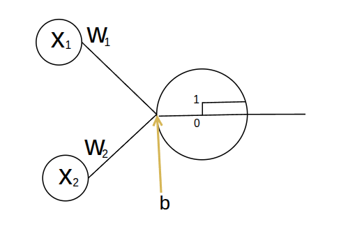

입력 데이터로 계산한 점수 $z = w_1 x_1 + w_2 x_2 + b$가 $0$보다 크면 합격($1$), 작거나 같으면 불합격($0$)으로 판정합니다.

$$
z=w_1x_1+w_2x_2+b
$$

$z$를 유닛 스텝 함수에 입력하면 $z>0$일 때 1(합격), $z\leq0$일 때 0(불합격)을 출력합니다.

위에 식을 그래프축에서 가로축을 x1, 세로축을 x2로 놓고 정리하면 아래와 같은 직선으로 그려지게 됩니다.

$$
x_2=-\frac{w_1}{w_2}x_1-\frac{b}{w_2}
$$

직선보다 위에 분포되어있는 데이터는 1, 아래 데이터는 0으로 분류합니다.

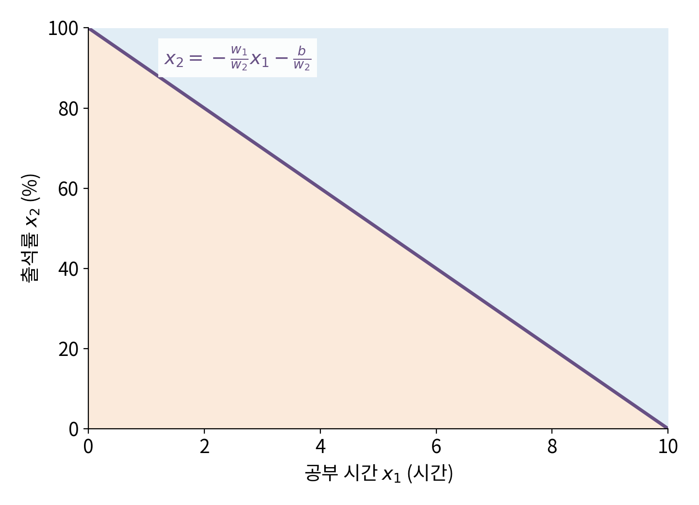

위 그림처럼, 복잡한 연산을 거치는 것 같지만 기하학적으로는 "2차원 평면 위에 직선 하나를 긋고, 직선 위쪽 데이터는 합격(1), 아래쪽 데이터는 불합격(0)으로 나누는 것" 입니다.

이처럼 두 클래스를 갈라놓는 기준선을 **결정 경계(Decision Boundary)** 라고 부르며, 직선이나 평면 형태로 경계를 만들어 분류하는 방식을 **선형 분류(Linear Classification)** 라고 합니다.

### 모델 학습

공부 시간과 출석률을 모델에 넣어 예측값을 구하고, 실제 합격 여부(정답 라벨)와 비교합니다. 이때 잘못 분류된 학생의 **예측 점수($z$)가 정답 방향으로 움직이도록** 가중치와 편향을 조정합니다.

이 과정을 반복하면서 두 부류를 가장 잘 가르는 최적의 경계선을 찾아갑니다.

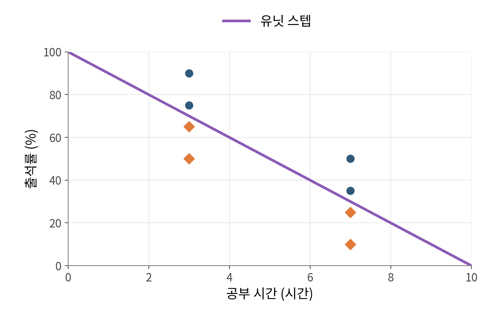

### 모델 테스트

학습에 쓰이지 않은 새로운 학생의 데이터를 입력하면 모델은 다시 점수 $z$를 계산합니다. 

이 점수가 $z>0$이면 '합격', $z\leq0$이면 '불합격'으로 판단합니다.

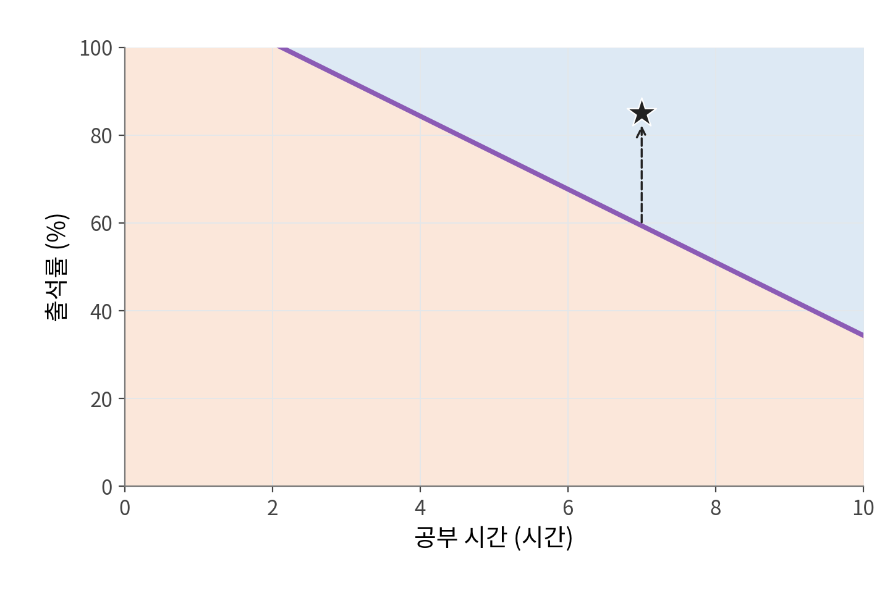

### 유닛 스텝 함수의 한계

**1. 경사하강법을 통한 학습 불가**
가중치를 수정했을 때 오차가 줄어드는지 확인하는 연속적인 피드백(기울기)을 받을 수 없어, **경사하강법(Gradient Descent)을 통한 가중치 최적화가 불가능**합니다.

- $z \neq 0$ 구간: 미분값이 0인 완전한 평지

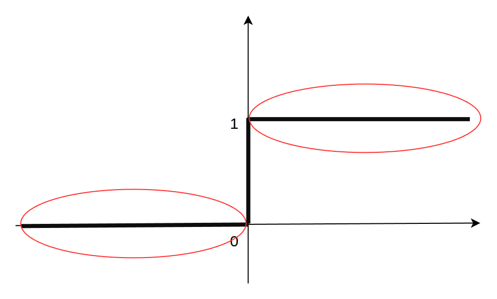

- $z = 0$ 구간: 불연속 지점으로 수학적 미분이 불가능합니다.

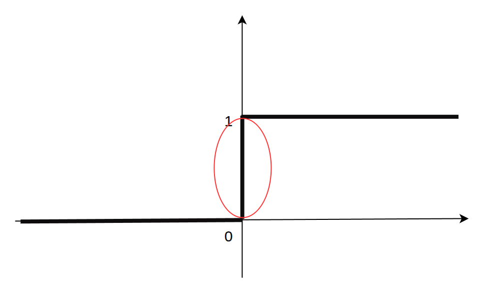

**2. 연속적인 확신도(Confidence) 부재 및 일반화 한계**

- 경계 바로 옆($z=0.01$)과 경계에서 멀리 떨어진($z=10$) 샘플을 모두 동일하게 1로 출력하여 예측의 불확실성을 반영하지 못합니다.
    
- 훈련 데이터가 분리되는 순간 학습이 종료되기 때문에, 결정 경계가 데이터에 바짝 붙어 마진(Margin)이 작아져도 보정하지 않아 테스트 데이터에 대한 일반화 성능이 떨어집니다.

이런 유닛 스텝 함수의 한계를 개선하기 위해 시그모이드 함수를 사용합니다.

## 3. 시그모이드(Sigmoid)

**시그모이드**(Sigmoid)는 함수에 입력되는 값을  0과 1 사이의 값로 바꿔주는 활성화 함수입니다.

시그모이드의 자세한 특징은 [3장 「활성화 함수」의 시그모이드 설명](/notes/deep-learning/linear-nonlinear-activations/#2-시그모이드sigmoid)에서 자세히 다룹니다.

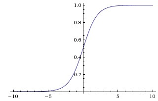

시그모이드 함수 공식
$$
출력값 p=\sigma(z)=\frac{1}{1+e^{-z}}
$$
$z$ : 함수 입력값 
$expontial$ 자연 상수 

### 시그모이드의 특징
시그모이드는 입력값을 0 ~1사이의 확률 형태로 변환함으로써 두 가지 결정적인 이점을 얻습니다.

**1. 문제 상황에 맞춰 합격 기준(임계값)을 유연하게 조절할 수 있습니다.**
단순히 0.5(50%)를 기준으로 삼는 데 그치지 않고, 판정을 더 엄격하게 하고 싶다면 기준을 0.8로 올리는 등 비즈니스나 도메인 목적에 맞게 의사결정 기준선을 직접 통제할 수 있습니다.

**2. 전 구간이 미분 가능해 경사하강법으로 학습할 수 있습니다.**
계단 함수처럼 기울기가 0이 되어버리는 평지 구간이 없습니다. 
출력이 매끄럽게 이어져 있으므로 오차를 기반으로 가중치와 편향을 정답 방향으로 정확하게 업데이트할 수 있습니다.

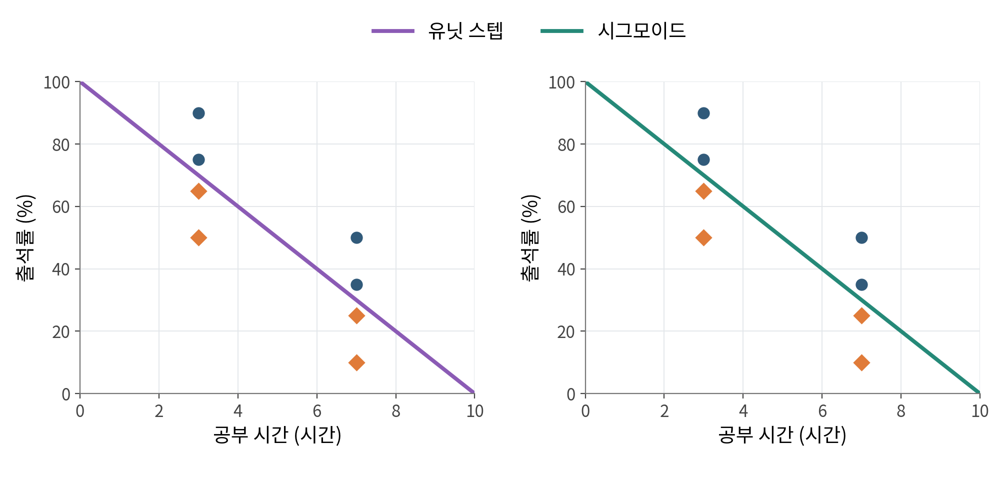
 
 
 실제 그래프에서 두 모델  데이터 6개을 모두 맞게 나누지만, 시그모이드 모델은 경계에 가까운 학생의 확신도까지 높이려 하므로 경계가 경계선이 훨씬 여유롭고 안정적인 위치에 놓입니다. 

## 4. 손실 함수

회귀에서는 손실 함수로 MSE(평균 제곱 오차)를 주로 쓰지만, 이진분류에서는 **이진 교차 엔트로피**(Binary Cross-Entropy, BCE)를 주로 사용합니다.

정답을 $y$(합격 1, 불합격 0), 시그모이드가 출력한 합격 확률을 $p$라고 하면 BCE는 다음과 같습니다.

$$
L_{\mathrm{BCE}} = -\Big[\,y\ln p + (1-y)\ln(1-p)\,\Big]
$$
ln = 자연로그기호

정답에 따라 한쪽 항만 남습니다.

- **정답이 1일 때:** 위식이  $L = -\ln p$ 로 되며  $p$가 1에 가까울수록 손실이 작아집니다.
		ex)  p = 0.9  $$-\ln(0.9) \approx 0.1054$$
		ex)  p = 0.01$$-\ln(0.01) \approx 4.6052$$

- **정답이 0일 때:** 위식이 $L = -\ln(1-p)$ 로되며  $p$가 0에 가까울수록 손실이 작아집니다.
		ex)  p= 0.9  
		$$1 - p = 1 - 0.9 = 0.1$$$$L = -\ln(0.1) \approx \mathbf{2.3026}$$
		ex)  p= 0.01  $$1 - p = 1 - 0.01 = 0.99$$$$L = -\ln(0.99) \approx \mathbf{0.0101}$$

이처럼 0과 1사이에서 반대의 값일수록 커지고 가까울수록 loss크기가 적어지게 만드는 손실함수입니다.

### 왜 익숙한 MSE 대신 BCE를 쓸까요? 

이유는 두 가지입니다. 

1. **학습 관점:** 크게 틀릴수록 가중치를 더 세게 고칩니다. 
2. **확률 관점:** 이진분류 데이터의 분포에서 자연스럽게 나오는 식입니다.

#### 이유 1. 크게 틀릴수록 기울기가 커져 파라미터를 강하게 수정한다

#### 손실값 비교

합격한 학생(정답 $y=1$)에 대해, 모델의 예측이 틀릴수록 두 손실이 어떻게 변하는지 보겠습니다.

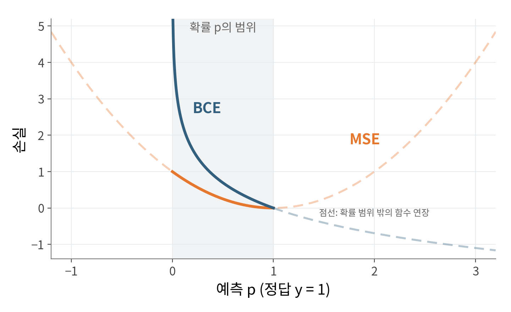

MSE는 아무리 크게 틀려도 손실이 1을 넘지 못하지만, BCE는 틀릴수록 손실이 끝없이 커집니다.

#### 역전파시 기울기 소실 문제

가중치를 고치려면 **가중치가 조금 바뀔 때 손실이 얼마나 바뀌는지** 알아야 합니다. 예측값 $\hat{y}$는 여기서 쓰는 합격 확률 $p$와 같습니다. 입력이 두 개인 뉴런에서 계산 흐름을 따라가 보겠습니다.

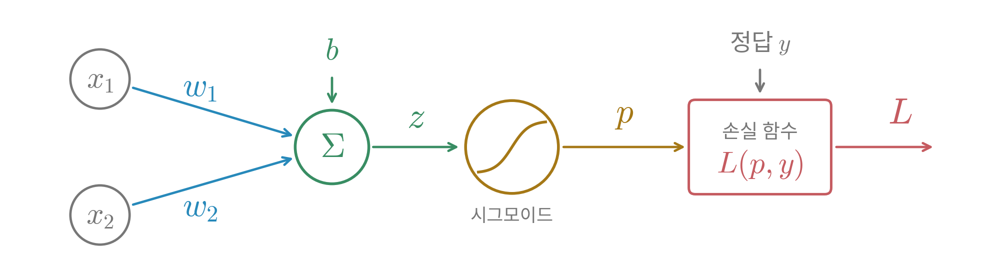

역전파는 **연쇄 법칙**으로 각 단계의 기울기를 곱해 가중치에 대한 손실의 기울기를 구합니다. $w_1$을 기준으로 각 항의 뜻은 다음과 같습니다.

- $\dfrac{\partial L}{\partial p}$: 예측 확률 $p$가 조금 바뀔 때 **손실이 얼마나 바뀌는지**. 손실 함수의 기울기입니다.
- $\dfrac{\partial p}{\partial z}$: 점수 $z$가 조금 바뀔 때 **예측 확률이 얼마나 바뀌는지**. 시그모이드의 기울기 $p(1-p)$입니다.
- $\dfrac{\partial z}{\partial w_1}$: 가중치 $w_1$이 조금 바뀔 때 **점수가 얼마나 바뀌는지**. $z=w_1x_1+w_2x_2+b$이므로 입력 $x_1$이 남습니다.

즉, 마지막 항은 단순히 '가중치의 기울기'가 아니라 **가중치에 대한 점수의 기울기**입니다. 구한 값을 $w_1 \leftarrow w_1-\eta\dfrac{\partial L}{\partial w_1}$에 넣어 업데이트합니다. $\eta$는 학습률입니다.

그렇다면 시그모이드의 기울기가 아주 작으면 어떻게 될까요? 데이터 한 개의 손실을 $L_{\mathrm{MSE}}=(p-y)^2$로 두고, 먼저 앞의 두 항을 곱해 보겠습니다.

$$
\begin{aligned}
\text{MSE:}\quad \frac{\partial L}{\partial z}
&=\underbrace{2(p-y)}_{\partial L/\partial p}\cdot\underbrace{p(1-p)}_{\partial p/\partial z}\\[6pt]
\text{BCE:}\quad \frac{\partial L}{\partial z}
&=\underbrace{\frac{p-y}{p(1-p)}}_{\partial L/\partial p}\cdot\underbrace{p(1-p)}_{\partial p/\partial z}=p-y
\end{aligned}
$$

시그모이드 출력은 $0<p<1$이므로 BCE에서는 분모의 $p(1-p)$와 시그모이드의 미분 항이 약분됩니다. 아래 오른쪽 그래프는 정답이 합격($y=1$)일 때 두 결과를 비교한 것입니다.

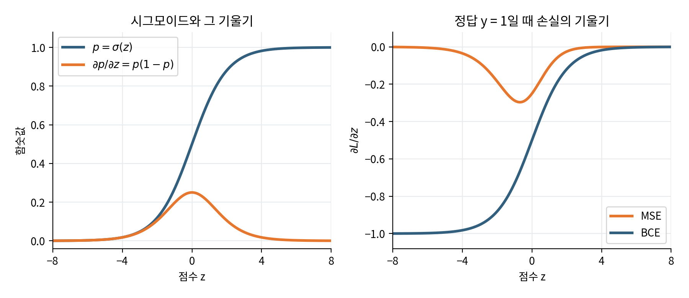

정답은 1인데 $p=0.01$로 틀리게 예측했다면, MSE의 $\dfrac{\partial L}{\partial z}$는 약 $-0.0196$, BCE는 $-0.99$입니다. 여기에 같은 입력 $x_1$을 곱하면 가중치에 대한 기울기가 됩니다.

**MSE는 크게 틀렸어도 시그모이드가 포화되면 기울기가 0에 가까워져 학습이 느려집니다.** 반면 BCE는 이 출력층에서 시그모이드의 작은 미분값 때문에 기울기가 줄어드는 문제를 피합니다. 다만 은닉층을 여러 번 거치며 생기는 기울기 소실까지 해결하는 것은 아닙니다.

### 이유 2. 확률 관점에서 자연스럽게 나온다

BCE는 "틀리면 벌점을 크게 주자"고 임의로 만든 식이 아닙니다. 이진분류 데이터가 따르는 확률 분포에서 그대로 유도됩니다.

#### 베르누이 분포

이진분류의 정답은 합격(1) 아니면 불합격(0), 두 가지뿐입니다. 이렇게 결과가 두 가지뿐인 시행의 분포를 **베르누이 분포**라고 합니다. (수학자 야코프 베르누이의 이름을 땄습니다.)

베르누이 분포는 "1이 나올 확률" $p$ 하나만 알면 전부 정해집니다. 1이 나올 확률이 $p$면, 0이 나올 확률은 $1-p$입니다.

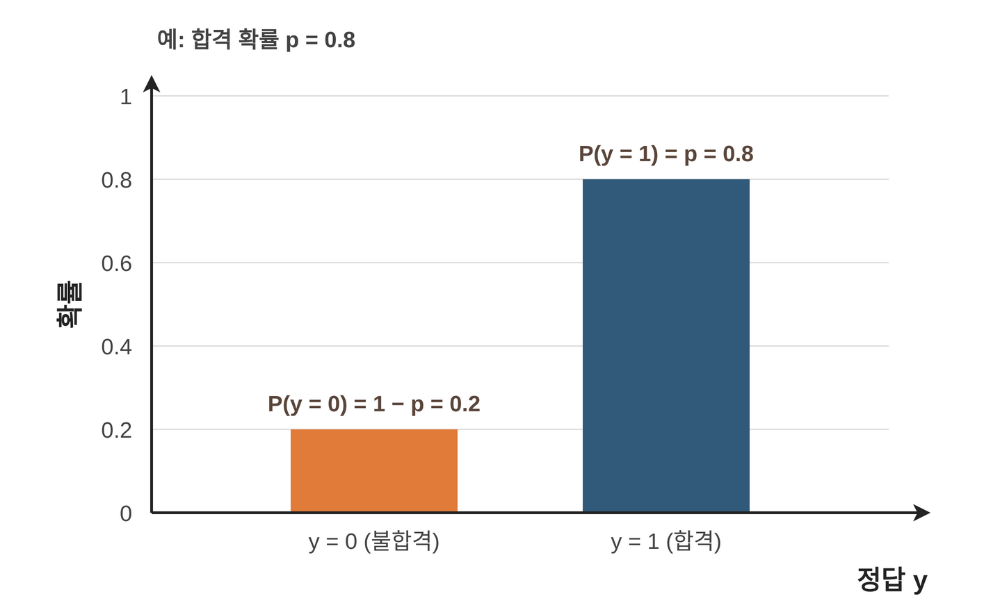

프로그래밍이라면 조건문(`if (y == 1) return p; else return 1-p;`)으로 나누겠지만, 수식에서는 지수 자리에 $y$와 $1-y$를 올려 한 줄로 씁니다.

$$
P(Y=y)=p^y(1-p)^{1-y}
$$

- $y=1$일 때: $p^1(1-p)^0=p$
- $y=0$일 때: $p^0(1-p)^1=1-p$

이렇게 한 식으로 써 두면, 데이터가 여러 개일 때 모든 확률을 하나의 곱으로 쓸 수 있습니다.

#### 우도와 최대우도추정

위 식은 $p$를 알고 있을 때 결과가 나올 확률을 구하는 식입니다. 하지만 **머신러닝은 반대 상황**입니다. 결과(합격/불합격)는 이미 알고 있고, 그 결과를 만든 $p$를 모릅니다.

그래서 관점을 뒤집어 **"이미 나온 결과를 가장 그럴듯하게 설명하는 $p$는 무엇일까?"** 를 묻습니다. 결과를 고정하고 $p$를 바꿔 가며 본 확률을 **우도**(Likelihood, 그럴듯함의 정도)라고 합니다.

동전을 10번 던져 앞면 7번, 뒷면 3번이 나왔다고 해 봅시다. 각 던지기는 서로 영향을 주지 않으므로(독립 시행), 우도는 각 확률을 모두 곱한 $p^7(1-p)^3$입니다.

- **$p = 0.5$일 때:** $(0.5)^7 \times (0.5)^3 \approx \mathbf{0.00098}$
- **$p = 0.7$일 때:** $(0.7)^7 \times (0.3)^3 \approx \mathbf{0.00222}$

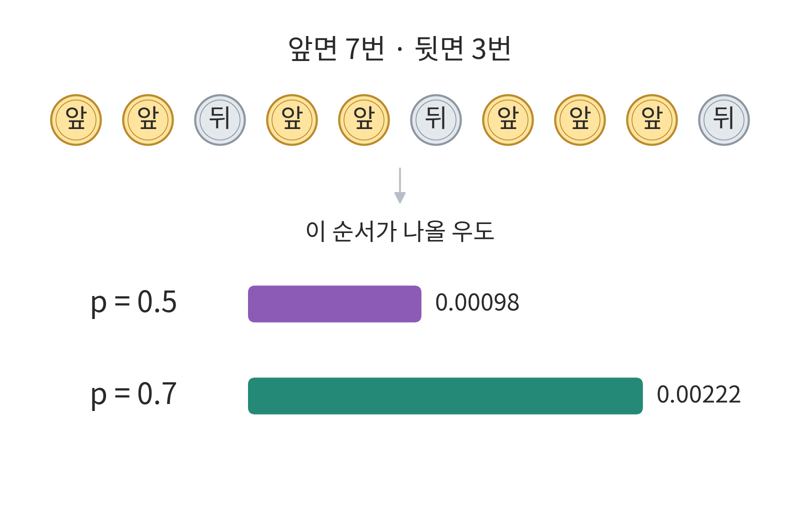

$p=0.7$일 때 우도가 더 크므로, 관측 결과를 더 잘 설명하는 값은 $0.7$입니다. 이렇게 우도가 가장 커지는 값을 찾는 방법을 **최대우도추정**(Maximum Likelihood Estimation, MLE)이라고 합니다.

#### 학생 여러 명의 우도

동전은 모든 시행에서 같은 $p$를 쓰지만, 학생은 공부 시간과 출석률이 달라서 합격 확률도 $p_1, p_2, \dots$처럼 제각각입니다. 각 $p_i$는 모델이 가중치 $w$와 편향 $b$, 시그모이드로 계산한 값입니다.

학생들의 결과가 서로 독립이라고 보면, 학생 6명 전체의 우도는 각 학생 확률의 곱입니다.

$$
\left[p_1^{y_1}(1-p_1)^{1-y_1}\right]
\times\cdots\times
\left[p_6^{y_6}(1-p_6)^{1-y_6}\right]
$$

모델 학습의 목표는 **이 우도를 가장 크게 만드는 $w$와 $b$를 찾는 것**이 됩니다.

#### 로그 씌우기

0과 1 사이의 확률을 계속 곱하면 값이 너무 작아져 컴퓨터가 0으로 처리하는 **언더플로**(underflow)가 생길 수 있습니다.

그래서 자연로그 $\ln$을 씌웁니다. 로그는 단조증가함수라서, 우도를 가장 크게 만드는 $w$와 $b$의 위치는 바뀌지 않습니다. 로그를 씌우면 두 가지가 바뀝니다.

- 곱셈이 덧셈으로: $\ln(ab) = \ln a + \ln b$
- 지수가 앞으로 내려와 곱해짐: $\ln a^{y} = y\ln a$

$$
\left[y_1\ln p_1+(1-y_1)\ln(1-p_1)\right]
+\cdots+
\left[y_6\ln p_6+(1-y_6)\ln(1-p_6)\right]
$$

#### 마이너스 부호 붙이기

경사하강법은 값을 **줄이는** 방법입니다. 우도를 "최대화"하는 문제를 손실을 "최소화"하는 문제로 바꾸기 위해 마이너스($-$)를 붙이고, 데이터 개수 $N$으로 나눠 평균을 내면 BCE가 완성됩니다.

$$
L_{\mathrm{BCE}}=-\frac{1}{N}\sum_{i=1}^{N}
\left[y_i\ln p_i+(1-y_i)\ln(1-p_i)\right]
$$

맨 처음 본 BCE 식을 학생 $N$명에 대해 평균 낸 것과 똑같습니다.

- [Dive into Deep Learning · 선형 회귀와 제곱 손실](https://d2l.ai/chapter_linear-regression/linear-regression.html).
