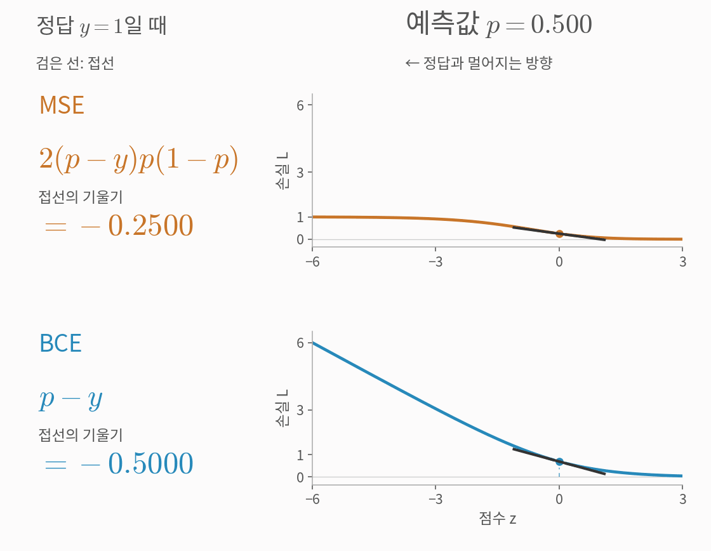

## 1. 이진 분류

이진 분류(Binary Classification)는 주어진 입력 데이터에 대해 'O냐 X냐'처럼 두 가지 선택지 중 하나를 판별하는 머신러닝 작업입니다. 세 개 이상으로 나누는 것은 다중 분류라고 합니다.

이진 분류 활용 예

- 스팸 / 정상 메일 구분
- 질병 진단
- 불량품 검사
- 시험 합격 예측

## 2. 이진 분류 과정

공부 시간과 출석률 데이터로 학생의 시험 합격 여부를 분류하는 예를 살펴보겠습니다.

### 데이터 수집

먼저 학습에 필요한 데이터를 수집합니다. 학생 6명의 입력 데이터와 정답 데이터를 수집했다고 가정해 봅니다.

### 모델 설계

모델로는 **유닛 스텝 함수**(계단 함수)를 활성화 함수로 쓰는 퍼셉트론을 사용해 보겠습니다. 입력 노드 $x_1$에는 공부 시간, $x_2$에는 출석률이 입력됩니다.

이 모델은 입력값들에 가중치를 곱하고 바이어스를 더한 $활성화함수입력값 = w_1 x_1 + w_2 x_2 + b$가 $0$보다 크면 합격($1$), 작거나 같으면 불합격($0$)으로 판정합니다.

$$
w_1x_1+w_2x_2+b > 0 : 1
$$
$$
w_1x_1+w_2x_2+b <= 0 : 0
$$

위 식에서 $< 0$을 $= 0$으로 놓고 정리하면, 가로축이 $x_1$, 세로축이 $x_2$인 그래프에서 아래와 같은 직선으로 나타납니다.

$$
x_2=-\frac{w_1}{w_2}x_1-\frac{b}{w_2}
$$

아래 그림에서는 직선 위쪽의 데이터를 1, 직선에 놓이거나 아래쪽에 있는 데이터를 0으로 분류합니다.

위 그림처럼 복잡한 연산을 거치는 것 같지만 기하학적으로는 "2차원 평면 위에 직선 하나를 긋고, 직선 위쪽 데이터는 합격(1), 아래쪽 데이터는 불합격(0)으로 나누는 것"입니다.

이처럼 두 클래스를 갈라놓는 기준선을 **결정 경계**(Decision Boundary)라고 부르며, 직선이나 평면 형태로 경계를 만들어 분류하는 방식을 **선형 분류**(Linear Classification)라고 합니다.

### 모델 학습

공부 시간과 출석률을 모델에 넣어 예측값을 구하고, 실제 합격 여부(정답 라벨)와 비교합니다. 이때 잘못 분류된 학생의 <strong>예측값이 정답 방향으로 움직이도록</strong>가중치와 편향을 조정합니다.

이 과정을 반복하면서 두 부류를 가장 잘 가르는 최적의 경계선을 찾아갑니다.

### 모델 테스트

학습에 쓰이지 않은 새로운 학생의 데이터를 입력하면 모델은 예측을 수행합니다.
이 예측값 $z>0$이면 '합격', $z\leq0$이면 '불합격'으로 판단합니다.

### 유닛 스텝 함수의 한계

**1. 경사하강법을 통한 학습 불가**
가중치를 수정했을 때 오차가 줄어드는지 확인하는 연속적인 피드백(기울기)을 받을 수 없어, **경사하강법(Gradient Descent)을 통한 가중치 최적화가 불가능**합니다.

- $z \neq 0$ 구간: 미분값이 0인 완전한 평지

- $z = 0$ 구간: 불연속 지점으로 수학적 미분이 불가능합니다.

**2. 연속적인 확신도(Confidence) 부재 및 일반화 한계**

- 경계 바로 옆($활성화함수입력값=0.01$)과 경계에서 멀리 떨어진($활성화함수입력값=10$) 샘플을 모두 동일하게 1로 출력하여 예측의 불확실성을 반영하지 못합니다.
- 훈련 데이터가 분리되는 순간 학습이 종료되기 때문에, 결정 경계가 데이터에 바짝 붙어 마진(Margin)이 작아져도 보정하지 않아 테스트 데이터에 대한 일반화 성능이 떨어집니다.

이런 유닛 스텝 함수의 한계를 개선하기 위해 시그모이드 함수를 사용합니다.

## 3. 시그모이드(Sigmoid)

**시그모이드**(Sigmoid)는 함수에 입력되는 값을 0과 1 사이의 값으로 바꿔 주는 활성화 함수입니다.

시그모이드의 특징은 [3장 「활성화 함수」의 시그모이드 설명](/notes/deep-learning/linear-nonlinear-activations/#2-시그모이드sigmoid)에서 자세히 다룹니다.

시그모이드 함수 공식

$$
출력값 p=\sigma(z)=\frac{1}{1+e^{-z}}
$$

$z$: 함수 입력값

$e$: 자연상수

### 시그모이드의 특징

시그모이드는 입력값을 0과 1 사이의 확률 형태로 변환함으로써 두 가지 결정적인 이점을 얻습니다.

**1. 문제 상황에 맞춰 합격 기준(임계값)을 유연하게 조절할 수 있습니다.**
단순히 0.5(50%)를 기준으로 삼는 데 그치지 않고, 판정을 더 엄격하게 하고 싶다면 기준을 0.8로 올리는 등 비즈니스나 도메인 목적에 맞게 의사결정 기준선을 직접 통제할 수 있습니다.

**2. 전 구간이 미분 가능해 경사하강법으로 학습할 수 있습니다.**
계단 함수처럼 기울기가 0이 되어버리는 평지 구간이 없습니다.
출력이 매끄럽게 이어져 있으므로 오차를 기반으로 가중치와 편향을 정답 방향으로 정확하게 업데이트할 수 있습니다.

위 그래프에서 두 모델은 데이터 6개를 모두 맞게 나누지만, 시그모이드 모델은 경계에 가까운 학생의 확신도까지 높이려 하므로 경계선이 더 여유 있는 위치에 놓입니다.

## 4. 손실 함수

회귀에서는 손실 함수로 MSE(평균 제곱 오차)를 주로 쓰지만, 이진 분류에서는 **이진 교차 엔트로피**(Binary Cross-Entropy, BCE)를 주로 사용합니다.

정답을 $y$(합격 1, 불합격 0), 시그모이드가 출력한 합격 확률을 $p$라고 하면 BCE의 수식은 다음과 같습니다.

$$L_{\mathrm{BCE}} = -\frac{1}{N} \sum_{i=1}^{N} \Big[ y_i \ln p_i + (1 - y_i) \ln(1 - p_i) \Big]$$

$\ln$: 자연로그 기호

### 왜 이런 함수가 나올까?

AI 학습은 “이 입력에는 이런 출력이 나와야 한다”를 반복적으로 알려 주는 과정입니다. 이를 손실 함수로 표현하면 손실을 최대한 줄이는 것입니다.
손실 함수는 합격 데이터에서 모델의 출력이 1에, 불합격 데이터의 모델 출력이 0에 가까울수록 작은 값을 가져야 합니다. 시그모이드 함수를 사용하므로 예측값 $p$는 0과 1 사이의 값을 가집니다.

합격 데이터를 입력할 때 $p$를 1에 가깝게 만드는 것은 $p$를 최대화하는 것과 같습니다. 반대로 불합격 데이터를 입력할 때는 $p$를 0에 가깝게 만들어야 합니다. 이는 $p$를 최소화하는 것, 즉 $1-p$를 최대화하는 것과 같습니다.
이를 하나로 표현하면 $p^y(1-p)^{1-y}$를 최대화하는 것과 같습니다. 정답에 따라 한쪽 항만 남습니다.

- 합격($y=1$)일 때: $p^1(1-p)^0=p$
- 불합격($y=0$)일 때: $p^0(1-p)^1=1-p$

즉, $p^y(1-p)^{1-y}$는 모델이 해당 정답에 부여한 확률로 해석할 수 있습니다.

미니배치(mini-batch) 방식으로 학습할 때는 각 데이터가 서로 독립이라고 가정하고, 여러 데이터의 정답에 부여한 확률을 모두 곱합니다.

예) 데이터가 6개일 때

$$
\left[p_1^{y_1}(1-p_1)^{1-y_1}\right]
\cdot\cdots\cdot
\left[p_6^{y_6}(1-p_6)^{1-y_6}\right]
$$

#### 로그 씌우기

0과 1 사이의 확률을 계속 곱하면 값이 너무 작아져 컴퓨터가 0으로 처리하는 **언더플로**(underflow)가 생길 수 있습니다. 그래서 자연로그 $\ln$을 씌웁니다. 로그를 씌우면 두 가지가 바뀝니다.

- 곱셈이 덧셈으로: $\ln(ab) = \ln a + \ln b$
- 지수가 앞으로 내려와 곱해짐: $\ln a^{y} = y\ln a$

$$
\left[y_1\ln p_1+(1-y_1)\ln(1-p_1)\right]
+\cdots+
\left[y_6\ln p_6+(1-y_6)\ln(1-p_6)\right]
$$

#### 마이너스 부호 붙이기

경사하강법은 값을 **줄이는** 방법입니다. 우도를 "최대화"하는 문제를 손실을 "최소화"하는 문제로 바꾸기 위해 마이너스($-$)를 붙이고, 데이터 개수 $N$으로 나눠 평균을 내면 BCE가 완성됩니다.

$$
L_{\mathrm{BCE}}=-\frac{1}{N}\sum_{i=1}^{N}
\left[y_i\ln p_i+(1-y_i)\ln(1-p_i)\right]
$$

## BCE에 실제 값 대입하기

**정답이 1일 때:** 위 식은 $L=-\ln p$가 되며, $p$가 1에 가까울수록 손실이 작아집니다.

- $p=0.9$일 때: $L=-\ln(0.9) \approx 0.1054$
- $p=0.01$일 때: $L=-\ln(0.01) \approx 4.6052$

**정답이 0일 때:** 위 식은 $L=-\ln(1-p)$가 되며, $p$가 0에 가까울수록 손실이 작아집니다.

- $p=0.9$일 때: $1-p=0.1$이므로 $L=-\ln(0.1) \approx 2.3026$
- $p=0.01$일 때: $1-p=0.99$이므로 $L=-\ln(0.99) \approx 0.0101$

이처럼 예측값이 정답에서 멀수록 손실이 커지고, 가까울수록 손실이 작아집니다.

### 왜 익숙한 MSE 대신 BCE를 쓸까요?

이유는 두 가지입니다.

1. **학습 관점:** 크게 틀릴수록 가중치를 더 세게 고칩니다.
2. **확률 관점:** 이진 분류 데이터의 분포에서 자연스럽게 나오는 식입니다.

#### 이유 1. 크게 틀릴수록 기울기가 커져 파라미터를 강하게 수정한다

#### 손실값 비교

합격한 학생(정답 $y=1$)에 대해, 모델의 예측이 틀릴수록 두 손실이 어떻게 변하는지 보겠습니다.

정답이 $y=1$일 때 MSE는 오차의 제곱인 $(p-1)^2$이므로, 그래프가 $p=1$을 꼭짓점으로 하는 이차 함수의 포물선입니다. BCE는 로그 함수에 마이너스 부호를 붙인 $-\ln p$이므로, $p=1$에서 손실이 0이고 $p$가 0에 가까워질수록 끝없이 커지는 곡선입니다.

따라서 예측값 $p$가 0과 1 사이일 때 MSE는 아무리 크게 틀려도 손실이 1을 넘지 못하지만, BCE는 틀릴수록 손실이 끝없이 커집니다.

#### 역전파 시 기울기 소실 문제

시그모이드는 출력이 0이나 1에 가까워지면 기울기가 작아집니다. 이 특성이 MSE와 BCE의 역전파에 어떤 차이를 만드는지 확인해 보겠습니다.

역전파는 **연쇄 법칙**으로 각 단계의 기울기를 곱해 가중치에 대한 손실의 기울기를 구합니다.

- $\dfrac{\partial L}{\partial p}$: 예측값 $p$가 바뀔 때 손실값의 변화율 = 손실 함수의 기울기
- $\dfrac{\partial p}{\partial z}$: 점수 $z$가 바뀔 때 예측값 $p$의 변화율 = 시그모이드 함수의 기울기 $p(1-p)$
- $\dfrac{\partial z}{\partial w_1}$: 가중치 $w_1$이 바뀔 때 점수 $z$의 변화율 = 가중치 $w_1$에 대한 가중합 함수의 기울기 $x_1$

위 식에서 손실 함수에 따라 달라지는 항은 $\dfrac{\partial L}{\partial p}$입니다.
시그모이드와 가중합의 미분은 같으므로, MSE와 BCE에서 이 항이 어떻게 달라지고 시그모이드의 기울기와 곱해지는지 보겠습니다.

$$
\begin{aligned}
\text{MSE:}\quad &(p-y)^2
\xrightarrow{\text{미분 시}} 2(p-y)\\[8pt]
\text{BCE:}\quad &-[y\ln p+(1-y)\ln(1-p)]
\xrightarrow{\text{미분 시}} \frac{p-y}{p(1-p)}
\end{aligned}
$$

여기에 시그모이드의 기울기 $p(1-p)$를 곱하면 아래처럼 BCE는 약분이 됩니다.

$$
\begin{aligned}
\text{MSE:}\quad &2(p-y)\cdot p(1-p)\\[8pt]
\text{BCE:}\quad &\frac{p-y}{\cancel{p(1-p)}}\cdot \cancel{p(1-p)}=p-y
\end{aligned}
$$

이 접선의 기울기에 같은 입력 $x_1$을 곱하면 가중치에 대한 기울기가 됩니다.

**MSE는 크게 틀렸어도 시그모이드가 포화되면 기울기가 0에 가까워져 학습이 느려집니다.** 반면 BCE는 이 출력층에서 시그모이드의 작은 미분값 때문에 기울기가 줄어드는 문제를 피합니다.

다만 은닉층을 여러 번 거치며 생기는 기울기 소실까지 해결하는 것은 아닙니다.

### 이유 2. 확률 관점에서 자연스럽게 나온다

BCE는 "틀리면 벌점을 크게 주자"고 임의로 만든 식이 아닙니다. 이진 분류 데이터가 따르는 확률 분포에서 그대로 유도됩니다.

#### 베르누이 분포

이진 분류의 정답은 합격(1) 아니면 불합격(0), 두 가지뿐입니다. 이렇게 결과가 두 가지뿐인 시행의 분포를 **베르누이 분포**라고 합니다. (수학자 야코프 베르누이의 이름을 땄습니다.)

베르누이 분포는 결과가 0 또는 1인 확률분포입니다. 1이 나올 확률을 $p$라 하면, 0이 나올 확률은 $1-p$입니다.

앞에서 정답에 부여한 확률을 나타낸 $p^y(1-p)^{1-y}$가 바로 베르누이 분포의 식입니다.

##### 관측한 결과를 가장 잘 설명하는 p 찾기

보통 확률 문제는 p를 알려 주고 결과를 묻습니다. "앞면이 나올 확률이 0.5인 동전을 10번 던지면, 앞면이 7번 나올 확률은?" 같은 식이죠.

그런데 머신러닝의 상황은 정반대입니다. **결과(데이터)는 이미 손에 있고, p를 모릅니다.** 그래서 관점을 뒤집어 "이미 나온 결과를 가장 그럴듯하게 설명하는 p는 무엇일까?"를 묻습니다. 결과를 고정해 두고 p를 바꿔 가며 계산한 확률을 **우도**(Likelihood, 그럴듯함의 정도)라고 합니다.

동전을 10번 던져 앞면 7번, 뒷면 3번이 나왔다고 해 봅시다. 각 던지기는 서로 영향을 주지 않으므로, 우도는 각 확률을 모두 곱한 $p^7(1-p)^3$입니다.

- p = 0.5일 때: $(0.5)^7 \cdot (0.5)^3 \approx \mathbf{0.00098}$
- p = 0.7일 때: $(0.7)^7 \cdot (0.3)^3 \approx \mathbf{0.00222}$

0.5보다 0.7일 때 우도가 두 배 넘게 큽니다. 0과 1 사이의 모든 p를 넣어 그래프를 그려 보면, 우도는 p=0.7에서 가장 높은 꼭짓점을 찍습니다.

10번 중 7번 앞면이 나왔으니 "앞면 확률은 0.7쯤"이라는 직관과도 정확히 맞아떨어집니다. 이처럼 이미 일어난 결과를 바탕으로 **우도가 가장 커지는 p를 찾는 방법**을 **최대우도추정**(Maximum Likelihood Estimation, MLE)이라고 합니다.

앞에서 구한 BCE도 같은 방식입니다. 각 데이터의 정답에 부여한 확률을 곱한 우도에 로그와 마이너스 부호를 붙이고 평균을 낸 것입니다.

- [Dive into Deep Learning · 선형 회귀와 제곱 손실](https://d2l.ai/chapter_linear-regression/linear-regression.html).
