## 1. 이진분류

**이진분류**(Binary Classification)는 입력되는 데이터를 두 클래스로 나누는 작업입니다.

세 개 이상으로 나누는 것은 다중분류라고 합니다.

이진분류 활용 예

- 스팸 / 정상 메일 구분
- 질병 진단
- 불량품 검사
- 시험 합격 예측

## 2. 퍼셉트론으로 이진분류

머신러닝에서 가장 기본적인 알고리즘인 퍼셉트론으로 이진분류를 해 보겠습니다. 공부 시간 $x_1$과 출석률 $x_2$로 학생 6명의 합격(1)과 불합격(0)을 예측합니다.

### 데이터 수집

먼저 학생 6명의 데이터를 수집했다고 가정합니다.

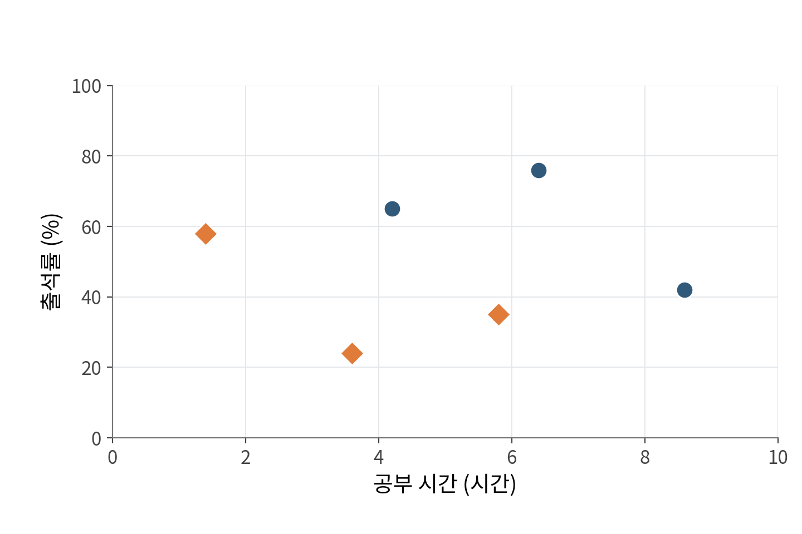

### 모델 설계

**유닛 스텝 함수**(계단 함수)를 사용하는 퍼셉트론을 사용하겠습니다. $x_1$에는 공부 시간, $x_2$에는 출석률이 입력됩니다.

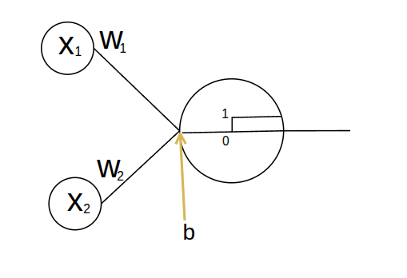

점수 $z=w_1x_1+w_2x_2+b$를 계산해, $z>0$이면 1을 출력하고 $z\leq0$이면 0을 출력합니다.

출력이 바뀌는 경계는 $z=0$인 점들입니다. 가로축을 $x_1$, 세로축을 $x_2$로 놓고 $z=0$을 $x_2$에 대해 정리하면 다음 직선이 됩니다.

$$
x_2=-\frac{w_1}{w_2}x_1-\frac{b}{w_2}
$$

$w_2>0$인 경우, 직선보다 위쪽은 1, 경계선과 아래쪽은 0으로 분류합니다.

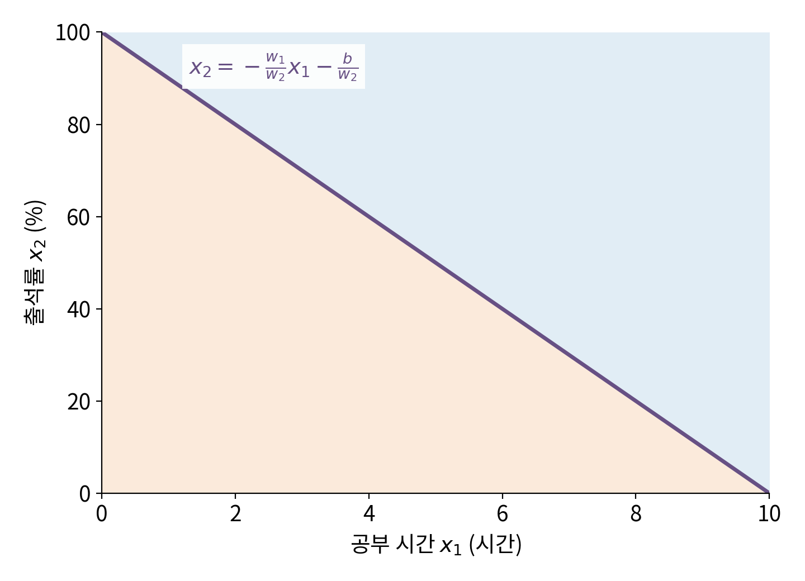

두 부류를 나누는 이 직선을 **분류 경계선**이라고 합니다. 이처럼 입력의 일차식으로 경계를 정하는 분류를 **선형 분류**라고 합니다.

### 모델 학습

공부 시간과 출석률을 모델에 넣어 예측값을 구하고, 실제 합격 여부인 정답 라벨과 비교합니다. 틀리게 분류한 학생의 점수 $z$가 정답 쪽으로 움직이도록 가중치와 편향을 조정합니다.

이를 반복해 두 부류를 나누는 경계를 찾습니다.

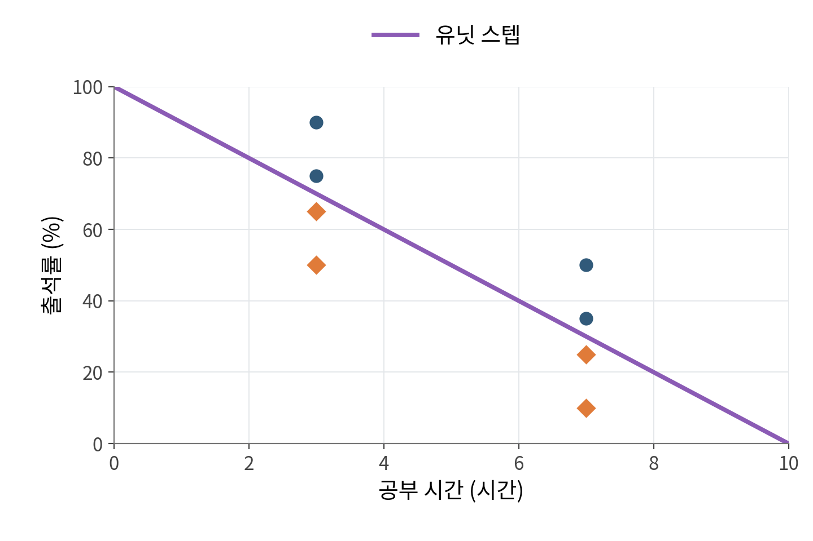

### 모델 테스트

학습에 쓰지 않은 새 학생의 공부 시간과 출석률을 넣고, 이 학생이 경계선의 어느 쪽에 놓이는지로 합격 여부를 예측합니다.

### 유닛 스텝 함수의 한계

- **기울기를 이용한 학습이 어렵습니다.** 경사하강법은 기울기를 보고 가중치를 움직일 방향을 정합니다. 그런데 유닛 스텝 함수는 $z\ne0$인 구간이 평평해 미분값이 0이고, $z=0$에서는 값이 끊겨 미분할 수 없습니다. 기울기가 0이면 가중치를 어느 쪽으로 움직여야 할지 알 수 없습니다.

    **$z \ne 0$인 모든 구간 (완전한 평지):**

    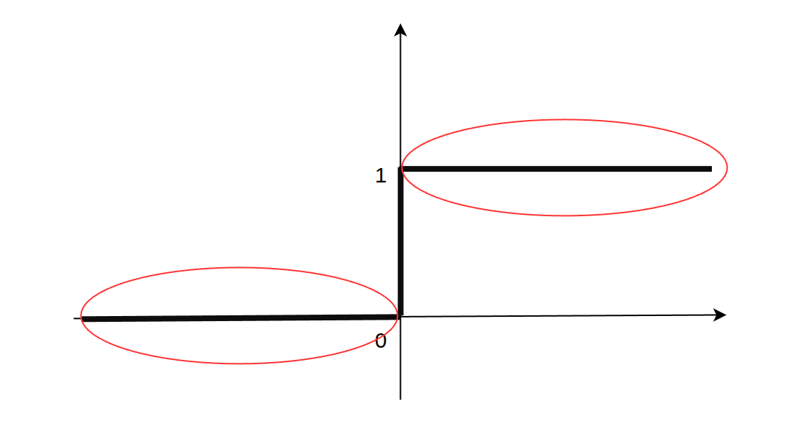

    **$z = 0$ 지점 (직각 절벽):**

    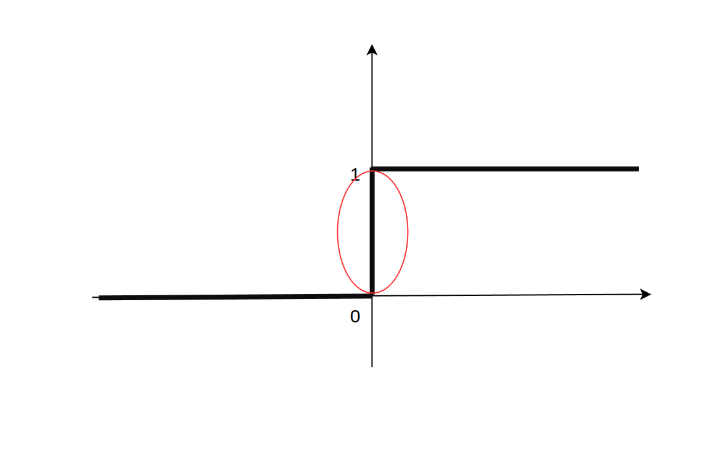

- **확신도를 구분하지 못합니다.** $z=0.01$과 $z=10$을 모두 1로 출력해, 경계에 가까운 예측과 멀리 떨어진 예측을 구분할 수 없습니다. 그래서 모든 학생을 맞게 나누는 순간 학습이 멈추고, 경계가 한쪽 학생에게 바짝 붙어 있어도 고치지 않습니다. 이런 경계는 새 학생을 틀리게 분류하기 쉽습니다.

이런 유닛 스텝 함수의 한계를 개선하기 위해 시그모이드 함수를 사용합니다.

## 3. 시그모이드(Sigmoid)

**시그모이드**(Sigmoid)는 점수 $z$를 0과 1 사이의 확률 $p$로 바꿔주는 활성화 함수입니다.

시그모이드의 자세한 특징은 [3장 「활성화 함수」의 시그모이드 설명](/notes/deep-learning/linear-nonlinear-activations/#2-시그모이드sigmoid)에서 자세히 다룹니다.

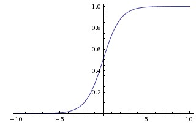

$$
p=\sigma(z)=\frac{1}{1+e^{-z}}
$$

### 시그모이드의 특징

1. **예측의 확신도를 구분합니다.** $z=0.01$이면 $p\approx0.5025$, $z=10$이면 $p\approx0.99995$입니다. 둘 다 합격이지만 확신도는 다릅니다.

2. **임계값을 조정할 수 있습니다.** 보통 $p\geq0.5$이면 합격으로 분류합니다. 임계값을 높이면 합격 판정이 더 엄격해집니다.

3. **모든 구간이 미분 가능합니다.** 계단 함수의 평지가 없으므로, 손실 함수를 정하면 경사하강법으로 가중치와 편향을 조정할 수 있습니다.

 그래프에서 두 모델  6명을 모두 맞게 나누지만, 시그모이드 모델은 경계에 가까운 학생의 확신도까지 높이려 하므로 경계가 좀더 정확합니다. 

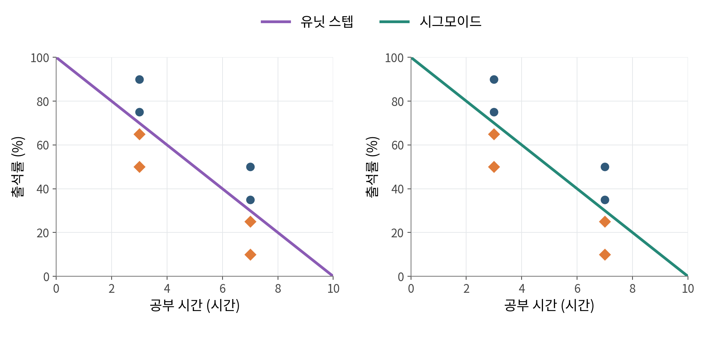

## 4. 손실 함수

회귀에서는 손실 함수로 주로 MAE나 MSE를 사용하지만, 이진분류에서는 **이진 교차 엔트로피**(Binary Cross-Entropy, BCE)를 사용합니다.

BCE를 사용하는 이유는 두 가지입니다.

1. 데이터 분포 관점
2. 시그모이드 함수와 손실 함수의 미분 관계

### 데이터 분포 관점

#### 베르누이 분포

이진분류의 정답은 합격(1) 아니면 불합격(0), 두 가지뿐입니다. 

이렇게 결과가 두 가지뿐인 시행의 확률분포를 **베르누이 분포**라고 합니다. (수학자 야코프 베르누이의 이름을 땄습니다.)

1이 나올 확률을 $p$라고 하면, 0이 나올 확률은 $1-p$입니다. 아래 그림은 합격 확률이 $p=0.8$인 경우입니다.

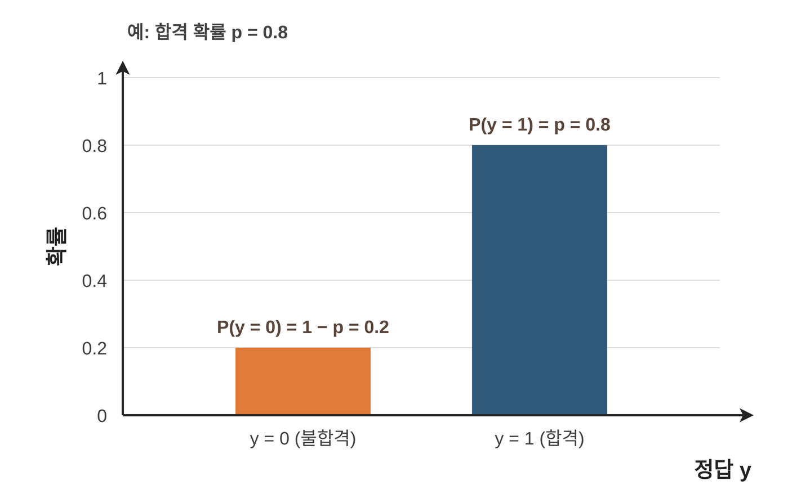

컴퓨터 프로그래밍이라면 `if (y == 1) return p; else return 1-p;`처럼 조건문으로 나눠 쓰면 됩니다. 수식에서는 지수 자리에 $y$와 $1-y$를 올려 한 식으로 씁니다.

$$
P(Y=y)=p^y(1-p)^{1-y}
$$

- $y=1$일 때: $p^1(1-p)^0=p$
- $y=0$일 때: $p^0(1-p)^1=1-p$

이렇게 한 식으로 써 두면, 데이터가 여러 개일 때 모든 데이터의 확률을 하나의 곱으로 쓸 수 있습니다.

#### 우도와 최대우도추정

앞면이 나올 확률이 $p$인 동전을 10번 던져 **[앞, 앞, 앞, 앞, 앞, 앞, 앞, 뒤, 뒤, 뒤]** 처럼 앞면이 7번, 뒷면이 3번 나왔다고 해 봅시다.

각 던지기는 서로 영향을 주지 않으므로(독립 시행), 이 결과가 나올 확률은 각 확률을 모두 곱한 $p^7(1-p)^3$입니다.

이미 나온 결과를 고정하고, 이 확률을 $p$의 함수로 본 것을 **우도**(Likelihood)라고 합니다. $p$ 후보 두 개의 우도를 비교해 보겠습니다.

- **$p = 0.5$일 때:** $(0.5)^7 \times (0.5)^3 \approx \mathbf{0.00098}$
- **$p = 0.7$일 때:** $(0.7)^7 \times (0.3)^3 \approx \mathbf{0.00222}$

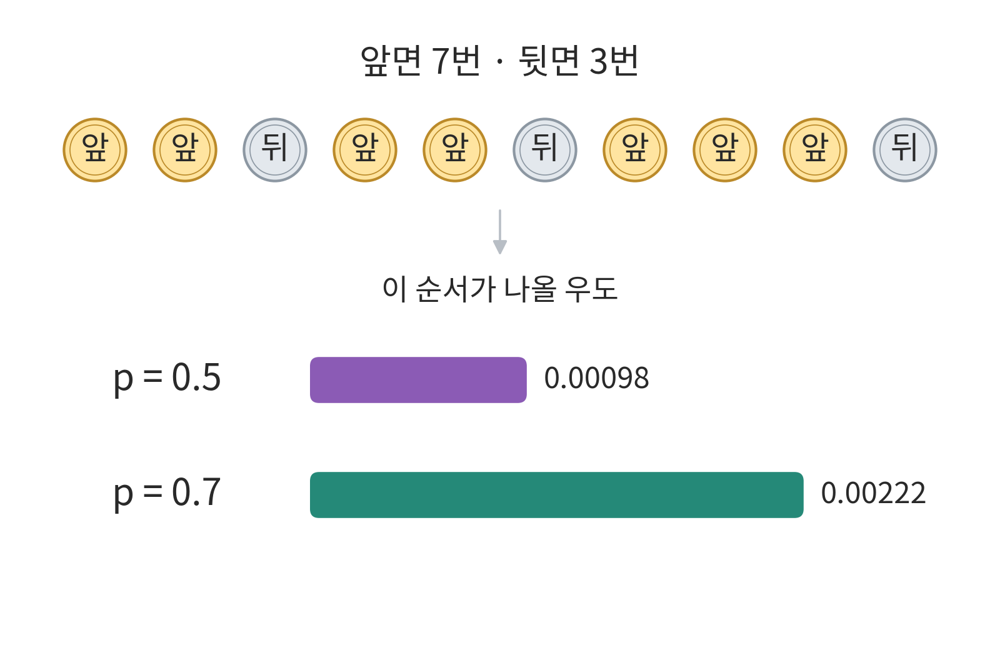

$p=0.7$이 관측된 결과를 더 잘 설명합니다. 실제로 이 우도는 $p=0.7$에서 가장 큽니다. 이렇게 우도가 가장 큰 파라미터를 고르는 방법을 **최대우도추정**(Maximum Likelihood Estimation, MLE)이라고 합니다.

#### 여러 데이터들의 우도를 구할때

동전은 모든 던지기가 같은 $p$를 씁니다.  학생마다 결과가 독립이라고 가정하면, 각 학생의 식을 모두 곱한 값이 우도입니다.  학생 6명이라면 다음과 같습니다.

$$
\left[p_1^{y_1}(1-p_1)^{1-y_1}\right]
\times\cdots\times
\left[p_6^{y_6}(1-p_6)^{1-y_6}\right]
$$

이 값이 가장 커지는 가중치와 편향을 찾는 것이 목표입니다.

#### log를 왜 추가하는 이유

데이터가 많아지면 확률을 계속 곱한 값이 너무 작아져, 컴퓨터가 0으로 처리하는 **언더플로**(underflow)가 생길 수 있습니다. 

그래서 곱에 자연로그를 씌웁니다. 로그는 단조증가함수이므로 최대가 되는 가중치와 편향은 같아서 문제가 없습니다. 로그를 씌우게 되면 곱이 덧셈으로 바뀌고 log가 곱해집니다.

$$
\left[y_1\ln p_1+(1-y_1)\ln(1-p_1)\right]
+\cdots+
\left[y_6\ln p_6+(1-y_6)\ln(1-p_6)\right]
$$

#### 마이너스를 추가하는 이유 

경사하강법은 값을 줄이는 방향으로 움직이므로, 마이너스를 붙여 최소화 문제로 바꿉니다. 

데이터 $N$개의 합을 $\sum$으로 줄여 쓰고 평균을 내면 BCE 손실이 됩니다.

$$
L_{\mathrm{BCE}}=-\frac{1}{N}\sum_{i=1}^{N}
\left[y_i\ln p_i+(1-y_i)\ln(1-p_i)\right]
$$

### 시그모이드 함수와 손실 함수의 미분 관계

정답이 합격($y=1$)인 학생에게 합격 확률 $p$를 예측했을 때, 두 손실은 다음과 같습니다.

- **MSE**: $(1-p)^2$
- **BCE**: $-\ln p$

MSE는 완전히 틀린 예측($p \to 0$)을 해도 손실이 1을 넘지 않습니다. 반면 BCE는 $p$가 0에 가까워질수록 손실이 한없이 커집니다.

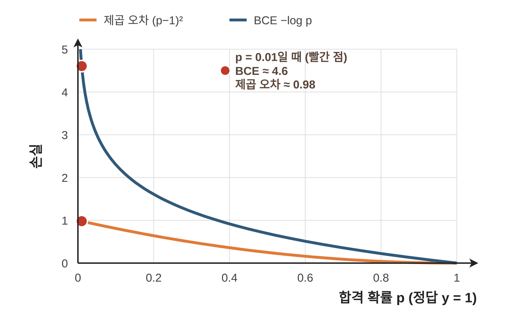

합격생에게 $p\approx0$을 예측했다는 것은 점수 $z$가 매우 작다는 뜻입니다. 이 구간에서 시그모이드는 평평해서, 기울기 $p(1-p)$가 0에 가깝습니다.

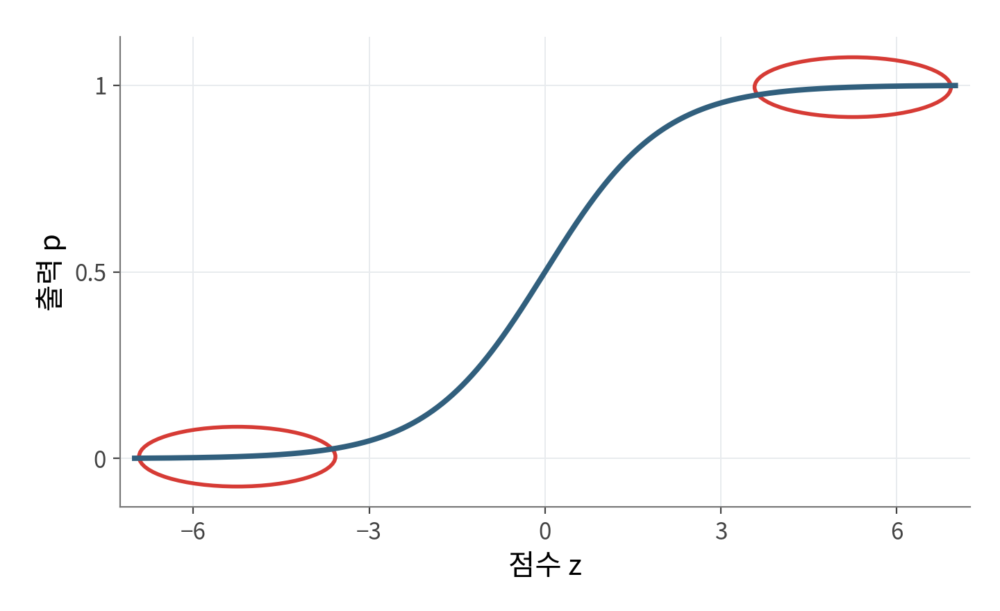

가중치를 고치는 기울기는 연쇄 법칙에 따라 손실의 기울기와 시그모이드의 기울기를 곱한 값입니다. 합격생에게 $p=0.01$을 예측한 경우입니다.

| 손실  | 손실의 기울기 | × 시그모이드의 기울기 | = $z$에 대한 기울기    |
| --- | ------- | ------------ | ---------------- |
| MSE | $-1.98$ | $0.0099$     | $\approx-0.0196$ |
| BCE | $-100$  | $0.0099$     | $-0.99$          |

MSE는 크게 틀렸는데도 기울기가 0에 가까워집니다. 이를 **기울기 소실**(Gradient Vanishing)이라고 합니다([7장](/notes/deep-learning/easy-deep-learning-ch06/)). BCE는 작은 시그모이드 기울기가 상쇄되어 오차 $p-y$가 그대로 남습니다.

## 참고 자료

- 혁펜하임, 『이지 딥러닝』, 챕터 4.
- [Stanford CS231n · 활성화 함수](https://cs231n.github.io/neural-networks-1/). 시그모이드 곡선 그림 출처.
- [Dive into Deep Learning · 최대우도추정](https://d2l.ai/chapter_appendix-mathematics-for-deep-learning/maximum-likelihood.html).
- [Dive into Deep Learning · 선형 회귀와 제곱 손실](https://d2l.ai/chapter_linear-regression/linear-regression.html).
