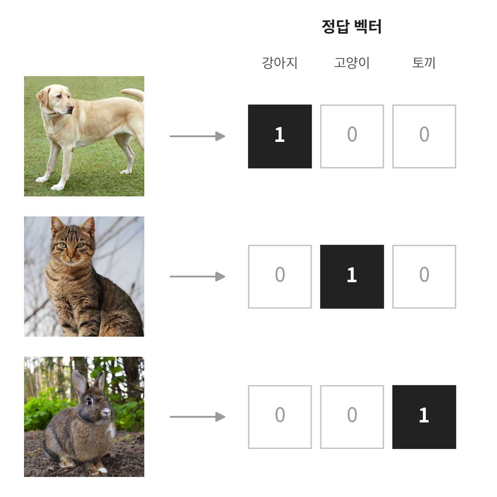
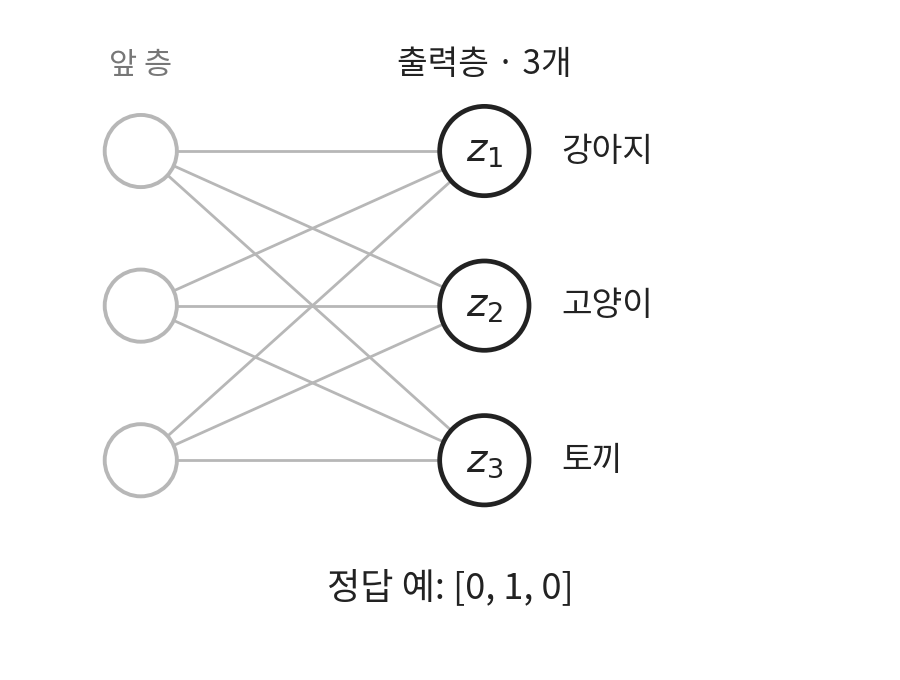

## 1. 다중분류

데이터를 세 개 이상의 클래스 중 하나로 분류하는 것을 다중분류라고 합니다.

예를 들어, 사진을 보고 **[강아지, 고양이, 토끼]** 중 어떤 동물인지 맞히는 작업이 있다고 해봅시다.
컴퓨터는 "이 사진은 고양이야"라는 글자를 그대로 이해하지 못하므로, 라벨 데이터를 **숫자 목록(벡터)** 형태로 알려주어야 합니다.

이때 쓰이는 방법이 원-핫 인코딩(One-Hot Encoding)입니다.  정답 클래스만 1로 표시하고 나머지는 전부 0으로 둡니다.

그리고 이진분류에서는 출력층에 노드 1개만 필요했지만, 다중분류에서는 라벨이 벡터로 표현됨에 따라 분류해야하는 클래스의 개수만큼 노드가 필요합니다. 

모델은 입력 이미지를 보고 클래스마다 점수 를 하나씩, 총 3개를 계산합니다.

$$\mathbf{z} = [z_1, z_2, z_3]$$

이 가공되지 않은 점수를 로짓(Logit)이라고 부릅니다. $z_1, z_2, z_3$은 각각 강아지, 고양이, 토끼에 대한 모델의 원시 점수입니다.

문제는 정답 벡터가 $0$과 $1$로만 이루어진 반면, 로짓은 $-3.1$, $5.2$처럼 음수도 나오고 범위에 제한이 없다는 점입니다. 
범위가 다른 두 값을 그대로 비교하면 오차(손실)를 일관된 기준으로 계산할 수 없습니다.
따라서 모델의 원시 점수(로짓)를 "모든 출력이 양수이고, 총합이 1이 되는 각 클래스의 확률"로 변환해야 합니다. 이 역할을 하는 대표적인 함수가 바로 소프트맥스(Softmax)입니다.

## 2. 소프트맥스(Softmax)

소프트맥스는 여러 개의 실수를 받아, 모든 출력이 0과 1 사이의 양수이면서 총합이 1이 되도록 변환하는 함수입니다.

각 클래스의 확률 $p_k$는 다음과 같습니다.

$$
p_k=\frac{e^{z_k}}{e^{z_1}+e^{z_2}+e^{z_3}}
$$

$k$는 클래스 번호(1: 강아지, 2: 고양이, 3: 토끼)이고, $e$는 자연상수(약 2.718)입니다.

$e^{z_k}$는 항상 양수이고, 모든 항을 같은 합으로 나누므로 확률의 합은 1입니다. 로짓이 클수록 확률도 큽니다.

로짓이 $[2,\ 1,\ 0]$이면 다음처럼 계산됩니다.

#### 소프트맥스 계산 과정

##### 입력값이 자연상수 지수로 쓰는 이유

로짓이 $[2, 1, 0]$처럼 모두 0 이상이라면 단순히 $\frac{2}{2+1+0}$처럼 비례 배분해도 확률처럼 보입니다. 

하지만 로짓이 $[2, 1, -1]$처럼 음수를 포함하면 문제가 생깁니다. 분모가 0이 될 수도 있고, 단순 합을 쓰면 확률의 정의를 벗어납니다.

"그렇다면 절댓값을 씌우면 되지 않을까?"라고 생각할 수 있습니다.

$$\frac{\vert{}-1\vert{}}{\vert{}2\vert{} + \vert{}1\vert{} + \vert{}-1\vert{}} = \frac{1}{4} = 0.25$$

하지만 절댓값을 취하면 원래 점수가 가장 낮았던 $-1$이 $+1$로 바뀌면서, 원래 점수가 $0$이었던 클래스보다 더 높은 확률을 부여받는 대소 관계 왜곡(순위 역전)이 발생합니다.

반면 지수 함수($e^z$)를 사용하면:

1. **대소 관계 유지 및 양수 보장:** 원래 점수가 음수여도 $0 < e^z < 1$ 범위의 작은 양수로 매핑되므로 대소 관계가 엄격하게 보존됩니다.
    
2. **미분의 편의성:** 밑이 자연상수 $e$인 지수 함수는 미분해도 자기 자신이 나오므로, 역전파 과정에서 그래디언트 계산이 수식적으로 매우 단순해집니다.

## 3. 카테고리컬 교차 엔트로피(Categorical Cross-Entropy, CCE)

다중 분류 모델이 안정적으로 학습하려면 적절한 손실 함수가 필요합니다. 
이진 분류에서는 동전 던지기 같은 **베르누이 분포**를 기반으로 BCE(Binary Cross-Entropy)를 유도했습니다.

다중 분류는 이를 **범주형 분포(Categorical distribution, 멀티누이 분포)** 로 자연스럽게 확장한 것입니다.

예를 들어 3개 클래스 [강아지, 고양이, 토끼] 중 정답이 강아지($y = [1, 0, 0]$)이고, 모델의 예측 확률이 $[\hat{y}_1, \hat{y}_2, \hat{y}_3]$라고 해봅시다.

모델을 학습시킬 때 우리의 목표는 **실제 정답 클래스의 예측 확률($\hat{y}_1$)을 1에 가깝게 최대화하도록 가중치를 갱신하는 것**입니다. 

그런데 수학식이나 연산 그래프에서는 조건문(`if 정답 == 강아지:`)을 사용하는 대신, 모든 클래스를 아우르는 하나의 단일 수식으로 정답 확률만 깔끔하게 뽑아내는 것을 선호합니다.

이를 위해 지수의 성질($x^1 = x$, $x^0 = 1$)을 스위치처럼 활용합니다.

$$\hat{y}_1^{y_1} \times \hat{y}_2^{y_2} \times \hat{y}_3^{y_3}$$

정답 원-핫 벡터($y = [1, 0, 0]$)를 지수에 대입해 보면 :

$$\hat{y}_1^1 \times \hat{y}_2^0 \times \hat{y}_3^0 = \hat{y}_1 \times 1 \times 1 = \hat{y}_1$$

오답 클래스는 지수가 0이 되어 1로 사라지고, **오직 정답 클래스의 예측 확률($\hat{y}_1$)만 곱셈 결과로 남습니다.**

이 연속된 곱셈을 수학 기호 $\prod$(파이)로 묶어 쓰면 다음과 같습니다.

$$P(\mathbf{y} \mid \mathbf{x}) = \prod_{c=1}^{K} \hat{y}_c^{y_c}$$
    

원-핫 벡터의 특성 덕분에, 위 식의 결과는 결국 모델이 실제 정답에 부여한 예측 확률($\hat{y}_{\text{정답}}$) 그 자체가 됩니다.
### 손실 함수(CCE) 유도: 우도에서 손실로

학습의 목표는 모델이 정답을 맞힐 확률(우도, Likelihood)을 최대로 만드는 것입니다. 하지만 경사하강법은 손실을 '최소화'하는 알고리즘이므로, 식에 음의 부호($-$)를 붙이고 자연로그($\ln$)를 씌워 손실 함수로 변환합니다.

로그를 취해 곱셈을 덧셈으로 바꾸는 이유는 두 가지입니다.

1. **언더플로우(Underflow) 방지:** 0~1 사이의 작은 확률값들을 계속 곱하면 부동소수점 한계로 인해 0으로 수렴해 버리지만, 로그를 취하면 덧셈으로 바뀌어 수치적으로 안정해집니다.
    
2. **미분의 단순화:** 복잡한 곱셈 연산보다 덧셈 항들의 미분이 역전파 계산에 훨씬 유리합니다.
    

이렇게 정의된 손실 함수가 바로 카테고리컬 교차 엔트로피(CCE)입니다.

$$\mathcal{L} = -\sum_{c=1}^{K} y_c \ln(\hat{y}_c)$$
### 실제 수치 대입

앞서 구한 Softmax 출력 $[0.665, 0.245, 0.090]$에서 실제 정답이 강아지($\mathbf{y} = [1, 0, 0]$)인 경우를 대입해 보겠습니다.

$$\mathcal{L} = -\bigl(1 \cdot \ln(0.665) + 0 \cdot \ln(0.245) + 0 \cdot \ln(0.090)\bigr) = -\ln(0.665) \approx 0.408$$

원-핫 벡터에서 0이 곱해지는 오답 클래스는 전부 사라지고, 오직 정답 클래스에 대한 항($-\ln(\hat{y}_{\text{정답}})$)만 남아 손실을 결정합니다.

- 모델이 정답 확률을 $1.0$에 가깝게 맞힐수록 손실은 $0$에 수렴합니다 ($-\ln(1) = 0$).
    
- 반대로 정답 확률을 $0$에 가깝게 잘못 예측할수록 손실은 무한대($\infty$)로 치솟아 모델에 강력한 페널티를 부여합니다 ($-\ln(0^+) \to \infty$).

정답 클래스에 부여한 확률이 $0$에 가까워질수록 손실은 무한대($\infty$)로 치솟아 모델에 강력한 페널티를 부여합니다.

이렇게 구한 CCE 손실 함수는 역전파 과정에서 Softmax와 결합되어 미분됩니다. 놀랍게도 복잡한 수식들이 다 상쇄되고 아주 직관적인 형태로 단순화되는데, 이 미분 유도 과정은 다음에 자세히 다뤄보겠습니다

## 참고 자료

- 혁펜하임, 『이지 딥러닝』, 챕터 4.
- [Dive into Deep Learning · softmax와 교차 엔트로피](https://d2l.ai/chapter_linear-classification/softmax-regression.html).
- 원-핫 인코딩 그림의 사진: [강아지](https://commons.wikimedia.org/wiki/File:YellowLabradorLooking_new.jpg) Djmirko, [CC BY-SA 3.0](https://creativecommons.org/licenses/by-sa/3.0/) · [고양이](https://commons.wikimedia.org/wiki/File:Cat_November_2010-1a.jpg) Alvesgaspar, CC BY-SA 3.0 · [토끼](https://commons.wikimedia.org/wiki/File:Oryctolagus_cuniculus_Rcdo.jpg) JM Ligero Loarte, [CC BY 3.0](https://creativecommons.org/licenses/by/3.0/). 잘라서 사용했고, 그림은 CC BY-SA 3.0을 따릅니다.
